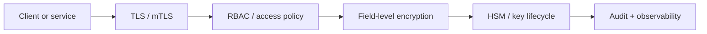

# Security in ThemisDB

Security is not a side feature in a database system. It is the layer that determines whether data can be trusted, accessed only by the right actors, and protected both while stored and while moving across networks. In ThemisDB, the security module implements that principle directly: it protects data at rest, secures service-to-service traffic, and enforces policy boundaries before data is processed or exposed.

The general challenge is simple: modern data platforms rarely have a single trust boundary. Data moves between services, operators, applications, and infrastructure layers, and every boundary creates risk. ThemisDB addresses this through a layered security model: field-level encryption, transport encryption, policy enforcement, identity validation, key lifecycle management, and auditability. This is not merely a compliance feature; it is the trust layer that allows enterprise deployments to handle sensitive information without giving up usability or operational speed.

The security module is tightly connected to the rest of ThemisDB. The server, query, storage, and observability components rely on it for secure boundaries, while audit and diagnostics make security-related events visible to operators. The platform therefore treats security as a cross-cutting system concern, not as a single isolated feature. The module-level descriptions in [README.md](./README.md) and the wider architectural framing in [ARCHITECTURE.md](./ARCHITECTURE.md) make that clear, and the same operational logic is reinforced by the broader material in the [compendium](./../../docs/compendium/docs/index.md).

The first core capability is data protection. With field-level encryption, sensitive values can be protected without forcing an all-or-nothing database-wide encryption decision. This matters in systems that mix public metadata with personal, regulated, or business-critical data. Protection works at the field boundary, so data can remain usable where needed while still being protected where risk is highest.

The second core capability is identity and trust at the transport layer. TLS and mTLS ensure that service-to-service communication is encrypted and authenticated, while PKI and certificate management keep trust relationships explicit and operable. In practice, this means the system can enforce clear service boundaries instead of relying on network assumptions alone.

The third core capability is policy and lifecycle management. RBAC, policy-based access checks, key rotation, and HSM-backed key handling are what turn encryption from a static feature into a real operational control plane. They let security administrators enforce least privilege, rotate material without downtime, and maintain a clear chain of trust in production environments.

The practical value is straightforward: stronger trust, better compliance readiness, and reduced operational risk. Security features do not just protect data; they reduce the chance that a single misconfiguration, leaked credential, or insecure transport path becomes a platform-wide incident. In enterprise contexts, that often translates directly into deployment confidence, auditability, and lower business risk.

Security is also operationally decisive because it defines the difference between a safe platform and one that merely appears to work. ThemisDB treats security as a boundary control problem, not as a cosmetic layer. The module is responsible for making trust boundaries explicit, keeping policy decisions enforceable, and ensuring that data protection and identity management remain visible to operators when systems change or incidents occur.

This page stays intentionally product-facing and source-aware. The normative security expectations remain in the module sources, especially [README.md](./README.md), [ARCHITECTURE.md](./ARCHITECTURE.md), [ROADMAP.md](./ROADMAP.md), [FUTURE_ENHANCEMENTS.md](./FUTURE_ENHANCEMENTS.md), and [PRODUCTION_REQUIREMENTS.md](./PRODUCTION_REQUIREMENTS.md). The supporting narrative is then anchored by the broader reference material in the compendium, which helps explain the systems-level role of secure transport, access control, and key management without substituting for the canonical module contract.
