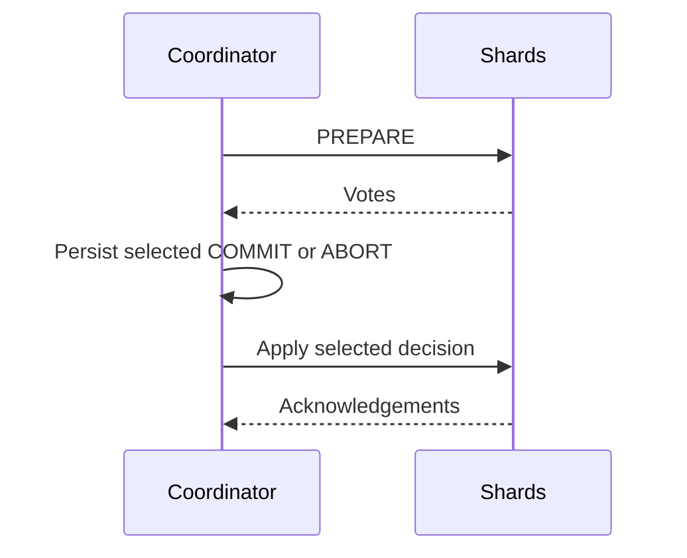

Exact model backend not verifiable from final document text alone.

# Sharding Module Architecture

## Kontext

`src/sharding/` owns partition topology, shard routing, distributed coordination/consensus adapters, cross-shard transaction orchestration, shard WAL integration, and migration/rebalance/repair operations. It does not own the underlying storage engine or the separate replication module's replica lifecycle.

## Komponenten

| Component | Public interface | Source-backed responsibility |
|---|---|---|
| Topology and routing | [`ShardRouter`](../../include/sharding/shard_router.h), [`ShardTopology`](../../include/sharding/shard_topology.h), [`AdaptiveShardRouter`](../../include/sharding/adaptive_shard_router.h) | Select routing strategy and address requests against configured shard topology. |
| Coordination | [`DistributedCoordinator`](../../include/sharding/distributed_coordinator.h), [`ConsensusFactory`](../../include/sharding/consensus_factory.h), [`QuorumManager`](../../include/sharding/quorum_manager.h) | Coordinate tasks and choose among the available consensus implementations. |
| Cross-shard transactions | [`CrossShardTransactionCoordinator`](../../include/sharding/cross_shard_transaction.h), [`TwoPhaseCommitCoordinator`](../../include/sharding/two_phase_commit_coordinator.h) | Preserve both public APIs; CrossShard retains its lifecycle/SSI/multi-protocol facade while delegating 2PC participant calls, durable decisions, and replay to the canonical coordinator. |
| Durability and operations | [`WALManager`](../../include/sharding/wal_manager.h), [`WALApplier`](../../include/sharding/wal_applier.h), [`AutoRebalancer`](../../include/sharding/auto_rebalancer.h), [`DataMigrator`](../../include/sharding/data_migrator.h) | Record/apply shard WAL state and manage rebalance/migration work. |

The source contains multiple consensus adapters (including Raft, Paxos, and Gossip); this architecture does not treat one adapter as the only supported implementation.

## Schnittstellen

`ShardRouter` addresses shard requests. `CrossShardTransactionCoordinator` and
`TwoPhaseCommitCoordinator` retain separate public lifecycles; CrossShard is a facade over the
canonical 2PC execution and recovery path rather than a second 2PC decision authority.

Both public APIs are retained. `TwoPhaseCommitCoordinator::commit()` is the standalone 2PC
entry point. CrossShard's separate prepare/commit/abort lifecycle delegates participant dispatch,
durable decision recording, and phase-two replay to the canonical coordinator while retaining
transaction validation and non-2PC protocols. A prepare failure selects ABORT. The durable
decision must precede phase two; a phase-two acknowledgement failure leaves an in-doubt state and
never changes the selected decision. When canonical WAL persistence is enabled, BEGIN records
include endpoint mappings so startup can restore transport and re-drive the selected phase-two
decision. Unresolved legacy CrossShard 2PC WAL/snapshot records fail startup; the old recovery
path does not replay them as a second authority.

CrossShard `TransactionWAL` and snapshots remain responsible for its non-2PC protocols. This
adapter does not establish a general cross-coordinator WAL format or close the separate DIS-06
recovery boundary. `DistributedTransactionCoordinator`, declared in
`distributed_transaction.h`, is a third 2PC-capable public surface with its own transaction,
endpoint, and recovery paths; it is not part of this contract. No direct production instantiations
of the named pair were found in `src/` or `include/` during the DIS-05 source review.
The shared-contract sub-scope does not close the canonical DIS-05 audit item:
coordinator selection, caller migration, and end-to-end validation remain open
in [`audit/ROADMAP.md`](../../audit/ROADMAP.md).

## Datenfluss

1. A query/request is classified and routed using the current topology and routing policy.
2. Remote execution and shard-local operations return results/status to the routing/coordinator path.
3. Cross-shard transactions coordinate participant work; the CrossShard 2PC lifecycle delegates prepare, decision, and phase two to `TwoPhaseCommitCoordinator`. Its canonical WAL records participant endpoints for restart replay; CrossShard WAL/snapshots remain for other protocols.
4. Rebalance, migration, and repair components act on topology/health information and report operation state to their callers.

Evidence includes [`shard_router.cpp`](shard_router.cpp), [`cross_shard_transaction.cpp`](cross_shard_transaction.cpp), [`wal_manager.cpp`](wal_manager.cpp), and [`auto_rebalancer.cpp`](auto_rebalancer.cpp).

## Sequenz (kritischer Ablauf)

Kurzinterpretation: Phase two follows only after the configured decision record
succeeds; missing acknowledgements leave that decision unresolved.

## Fehlerpfade und Resilienz

- Invalid or empty topology and unavailable target shards prevent normal routing; remote execution errors are distinct from local planning errors.
- Quorum/consensus outcomes can prevent a coordination decision. An in-doubt transaction is a separate recovery state, not a confirmed commit.
- WAL persistence/replay errors affect shard state recovery; migration/rebalance conflicts can leave an operation incomplete and require the operation-specific recovery path.
- Timeouts, circuit breakers, and health monitors are component-specific; no universal automatic failover behavior is assumed.

## DIS-03: Routing- und Snapshot-Grundlagen

**Status: Implementierung der Grundlagen freigegeben und begonnen; Produktions-
Export und Ownership-Cutover bleiben gesperrt.** `RoutingKeyDescriptor`,
`RingOwnershipSnapshot` und der MVCC-Snapshotreader sind implementiert und
fokussiert getestet. Bestehende Routingverfahren und Platzierung bleiben
unverändert. Die APIs verknüpfen jedoch keine durable Assignment-Autorität mit
dem laufenden Routing und stellen weder Range-Quieszenz noch einen
autoritativen Fencing-Cutover bereit. Sie erweitern deshalb nicht die
Produktionsfreigabe der bestehenden [Transfer-APIs](API.md#shard-transfer-dis-03).

#### Typisierte Routing-Identität ohne impliziten Hashwechsel

`RoutingKeyDescriptor` trägt Schlüsseltyp, exakte Schlüsselbytes,
Algorithmus-ID und nichtnull Topologie-Epoche. `resolveRoutingToken()` und
`ownsKeyInSnapshot()` verweigern unbekannte oder unpassende Kombinationen.
Die Descriptor-Epoche muss der explizit aufgenommenen Ring-Snapshot-Epoche
entsprechen. Persistente Placement-Konfiguration, Assignment-Autorisierung
und bestehende Routingpfade sind nicht daran angebunden; kein automatischer
Wechsel bei fehlender Bibliothek, unbekannter Version oder Schlüsseltyp.

| Schlüsseltyp | Bestehende Abbildung | Implementierter expliziter Tokenvertrag |
|---|---|---|
| Partition-Key | `ConsistentHashRing::getNode()` / `hashKey()`: FNV-1a und 64-Bit-Mix über die gelieferten Bytes | `partition-key/fnv1a-mix64-v1`; keine neue Namespace-Präfixierung, Unicode-Normalisierung oder andere Byteänderung |
| URN-UUID | `getShardForURN()` delegiert an `URN::hash()`: UUID-String, xxHash64 mit Seed 0 wenn verfügbar | `urn-uuid/xxh64-seed0-v1` wird nur mit xxHash-Unterstützung auf den bestehenden UUID-Stringbytes aufgelöst, nicht auf die gesamte URN oder binär dekodierte UUID |
| URN-UUID ohne xxHash | bestehende Produktionsroute nutzt `std::hash<std::string>` | `resolveRoutingToken()` lehnt den portablen Vertrag ab; bestehende Route bleibt unverändert, aber kein Transfer-Token wird erzeugt |

Quelle: [`consistent_hash.cpp`](consistent_hash.cpp) und [`urn.cpp`](urn.cpp).
`URNResolver::getShardForKey()` ignoriert derzeit das Collection-Argument;
der Entwurf fügt es nicht heimlich zum Hashinput hinzu. Er vereinheitlicht den
Vertrag, nicht ungeprüft die bestehenden Tokenwerte. Eine Änderung des
Algorithmus oder der Schlüsselbytes braucht Inventarisierung der Bestände,
Vergleich alter/neuer Placement-Ergebnisse, explizite Umzugsentscheidung und
einen getrennten, gefenceten Rollout. Vor Cutover ist ein Abbruch möglich;
nach Cutover gilt die persistierte Authority-Entscheidung, kein automatischer
Rollback auf die alte Abbildung.

#### Exakte Ownership statt Min/Max-Hülle

`RingOwnershipSnapshot` bindet die tatsächlich eingefügten Ringtokens und ihre
Besitzer an eine Aufrufer-Epoche und einen SHA-256-Ring-Fingerprint. Für
Ringtoken `t` mit Vorgänger `p` besitzt der bei `t`
eingetragene Shard das Segment **(p, t]** im Uhrzeigersinn; dies folgt aus
`getShardForHash()` mit `lower_bound`. Ein Token am Endpunkt gehört zum
Endpunktbesitzer, nicht zum nächsten Segment.

- Segmente eines Shards werden einzeln exportiert, niemals als Hülle aus
  `getShardRange()`; virtuelle Knoten können durch fremde Segmente getrennt sein.
- Wrap-around wird in zwei lineare Intervalle zerlegt. Für eine normalisierte
  halb-offene Darstellung wird `2^64` als eigener oberer Endmarker modelliert,
  nicht als überlaufender `uint64_t`. Das letzte Token bleibt darstellbar.
- Ein Ringtoken bedeutet Vollringbesitz; ein leerer Ring bedeutet keine
  autorisierte Ownership. Gleiche Grenzen bedeuten nicht implizit Vollring.
  Kollisionen richten sich nach den tatsächlich eingefügten Tokens, nicht
  nach einer nachträglich neu berechneten VNode-Liste.
- `ownsKeyInSnapshot()` löst typisierte Schlüssel erneut auf und prüft
  Tokenbesitz samt Epochengleichheit. Dies ist eine lokale Geometrieprüfung,
  keine durable Autorisierung und sperrt nicht selbst Admission, Resume oder
  Finalisierung.

Die heutige Transfer-Manifest-Range ist auf aufsteigende `uint64_t`-Grenzen
beschränkt. Mehrsegment-, Vollring- und oberste Token-Abbildung erfordern einen
explizit versionierten Manifestvertrag; das aktuelle Format wird nicht
stillschweigend umgedeutet.

#### Storage-eigener atomarer Snapshot

`MVCCStore::SnapshotReader` hält über `RocksDBWrapper::SnapshotHandle` genau
einen echten RocksDB-Snapshot, dessen **eigene** Sequenznummer und einen
MVCC-HLC-Grenzwert. Schlüsselermittlung und Versionsauswahl nutzen denselben
Snapshot; ein separater neuester DB-Sequenzwert oder unabhängige
`getAtTimestamp()`-Reads ersetzen diese Sicht nicht. Der Reader ist
prozesslokal und baut keinen durable Export für Source-Restart-Resume.

Für die erste Freigabe zuerst alle Schreibpfade der Range wirksam sperren,
bereits laufende Transaktionen bis Commit/Abort drainen und den Fence bis zur
Ownership-Entscheidung halten. Erst danach werden Snapshot und Watermarks
aufgenommen. HLC allein beweist keine Commit-Sichtbarkeit:
`putInTxn()` vergibt Zeitstempel vor Commit. Ein vor dem Watermark
zeitgestempelter, erst nach Snapshotaufnahme committeter Datensatz darf
deshalb nicht nachträglich in den Export gelangen.

Die Assignment bindet Operation-ID und Migration-ID, beide Shards, Rollen,
Epoch und den Manifest-Fingerprint dauerhaft. X.509-Identität wird auf einen
Cluster-Principal abgebildet; nur dessen zugewiesene Rolle darf PREPARE,
Stream, Resume oder Abort ausführen. Cutover benötigt eine eigene Berechtigung.
Nach Source-Restart muss der Fence wiederhergestellt und die Assignment
revalidiert werden, bevor normale Range-Schreibzugriffe zugelassen werden;
eine Prozesssperre allein ist keine crashfeste Quieszenz.

Die implementierte Storage-Schnittstelle selektiert pro logischem Schlüssel
die bei der Snapshot-Sequenz committete neueste Version mit HLC kleiner/gleich
dem Grenzwert. Sie liefert explizite `Put`/`Delete`-Datensätze, prüft
Iteratorstatus und Storage-I/O, unterstützt Cancellation und begrenzt Anzahl
und Bytes. Die bestehende MVCC-Repräsentation kann ein leeres PUT nicht von
einem Tombstone unterscheiden; leere Werte werden daher als `Delete`
exportiert. Callback-/I/O-Fehler sind keine leere Range.

Der Snapshotreader materialisiert keinen kanonischen Transfer-Export und
schreibt weder Manifest noch Resume-Checkpoint durable. Nach Verlust des
Handles ist daher eine neue Migration-Sicht nötig; es gibt keine
Source-Restart-Resume-Garantie. Die Storage- und Routingbausteine sind noch
nicht mit dem gRPC-Transferadapter, einem dauerhaften Assignment oder einem
Fencing-/Quieszenzmechanismus verbunden.

#### Explizite Löschsemantik und isolierter Import

Ein vorgeschlagenes `LogicalSnapshotRecord` trägt einen expliziten Typ
`PUT` oder `DELETE`, Schlüsselbytes und Versionsmetadaten; ein leeres PUT
bleibt von DELETE unterscheidbar. Die heutige MVCC-Repräsentation verwendet
leere Werte als Tombstones. Der Adapter darf daraus keine nachträglich
erfundenen leeren Live-Werte rekonstruieren; Storage-Maintainer müssen
Bestandssemantik und gegebenenfalls Formatmigration festlegen.

Kanonische Reihenfolge ist byteweise nach logischem Schlüssel, ohne doppelte
Schlüssel, mit versionierter längenbasierter Kodierung einschließlich Typ und
Watermarks. Tombstones werden im abgeschlossenen logischen Snapshot bewahrt;
Import erfolgt in ein leeres, migrationseigenes Staging-Namespace, nicht als
Merge in bestehende sichtbare Daten. Sekundärindizes und weitere abgeleitete
Strukturen benötigen einen ausdrücklich abgenommenen Rebuild-/Importvertrag.
Der heutige Key/Value-Materializer kodiert keinen Record-Typ und darf nicht
als Implementierung dieses neuen Formats ausgegeben werden.

#### Freigabereihenfolge und Human-Abnahme

1. **Routing-Kompatibilität:** Schlüsseltyp/Algorithmus/Bytes pro Placement
   inventarisieren; feste Tokenvektoren und plattformübergreifende Ergebnisse
   abnehmen. Kein Hash-/Placementwechsel ohne genehmigten Datenumzug.
2. **Ownership:** für jeden Grenztoken Gleichheit zur tatsächlichen Ringroute,
   VNode-Lücken, Token 0/Maximum, Wrap-around, Vollring und leeren Ring beweisen.
3. **Snapshot:** reale Storage-Tests für atomare Enumeration, konkurrierende
   Commits, GC, Tombstones, Restart und fehlerhaftes/abgebrochenes I/O.
4. **Transport:** Zwei-Prozess-mTLS mit nichtleerer Range, persistierten
   Zielrecords nach Restart, Resume, identischem/konfligierendem Replay,
   falscher Identität/Epoche, Checksumfehler und durablem Abort.
5. **Cutover:** gesondertes HA-Gate für wirksame Quieszenz, dauerhaft atomare
   Authority-Entscheidung, Publikation nur nach dieser Entscheidung und
   Reconciliation nach verlorener Bestätigung. Ein Transport-PASS ist kein
   HA-PASS; alle Pre-Cutover-Fehler lassen die Quelle autoritativ.

Abnahme ausstehend: Sharding-Maintainer (typisierte Placement-Identität,
Segmente, Manifestversion), Storage-Maintainer (Snapshot, Tombstones,
durabler Export, abgeleitete Strukturen) und Cluster/Operations-Maintainer
(Assignments, Quieszenz, Authority und Restart-Recovery). Diese Rollen sind
Review-Zuständigkeiten, keine behaupteten Unterschriften.

## Nicht-Ziele

- Owning record persistence, RocksDB internals, or general backup/PITR.
- Owning replication-manager membership and WAL-to-replica delivery.
- Query-language parsing or client transport protocol handling.
- Assuming every configured consensus backend, cloud adapter, or optional hardware path is enabled.

## Verweise

| Boundary | Evidence and link |
|---|---|
| Query federation | `query_federation.cpp` requires a `sharding::ShardRouter`; see [query architecture](../query/ARCHITECTURE.md). |
| Storage WAL | `wal_manager.cpp` includes `storage/wal_storage.h`; see [storage architecture](../storage/ARCHITECTURE.md). |
| Replication separation | Replication and sharding have separate public contracts; see [replication architecture](../replication/ARCHITECTURE.md). |

- [Module README](README.md) · [API notes](API.md) · [module roadmap](ROADMAP.md)
- [`sharding_api_contract.h`](../../include/sharding/sharding_api_contract.h) · [`shard_router.h`](../../include/sharding/shard_router.h) · [`cross_shard_transaction.h`](../../include/sharding/cross_shard_transaction.h)
