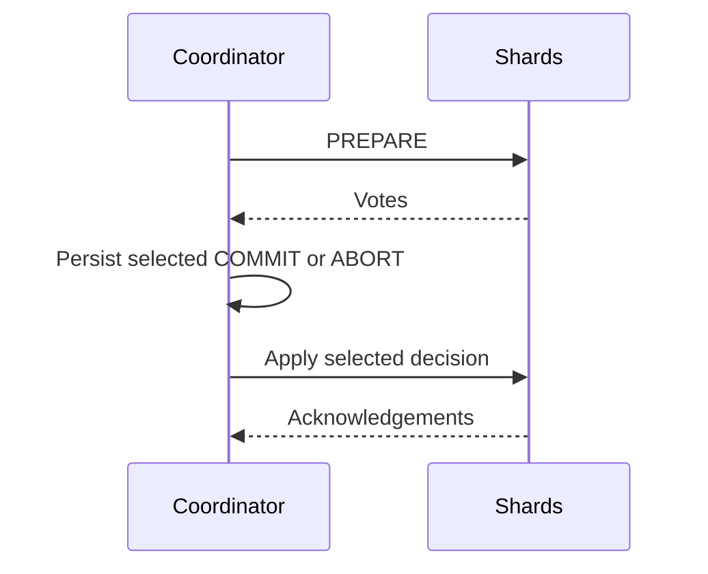

Exact model backend not verifiable from final document text alone.

# Sharding Module Architecture

## Kontext

`src/sharding/` owns partition topology, shard routing, distributed coordination/consensus adapters, cross-shard transaction orchestration, shard WAL integration, and migration/rebalance/repair operations. It does not own the underlying storage engine or the separate replication module's replica lifecycle.

## Komponenten

| Component | Public interface | Source-backed responsibility |
|---|---|---|
| Topology and routing | [`ShardRouter`](../../include/sharding/shard_router.h), [`ShardTopology`](../../include/sharding/shard_topology.h), [`AdaptiveShardRouter`](../../include/sharding/adaptive_shard_router.h) | Select routing strategy and address requests against configured shard topology. |
| Coordination | [`DistributedCoordinator`](../../include/sharding/distributed_coordinator.h), [`ConsensusFactory`](../../include/sharding/consensus_factory.h), [`QuorumManager`](../../include/sharding/quorum_manager.h) | Coordinate tasks and choose among the available consensus implementations. |
| Cross-shard transactions | [`CrossShardTransactionCoordinator`](../../include/sharding/cross_shard_transaction.h), [`TwoPhaseCommitCoordinator`](../../include/sharding/two_phase_commit_coordinator.h) | Both APIs remain; CrossShard delegates 2PC decisions/replay to the canonical durable coordinator, retaining its lifecycle and other protocols. |
| Durability and operations | [`WALManager`](../../include/sharding/wal_manager.h), [`WALApplier`](../../include/sharding/wal_applier.h), [`AutoRebalancer`](../../include/sharding/auto_rebalancer.h), [`DataMigrator`](../../include/sharding/data_migrator.h) | Record/apply shard WAL state and manage rebalance/migration work. |

The source contains multiple consensus adapters (including Raft, Paxos, and Gossip); this architecture does not treat one adapter as the only supported implementation.

## Schnittstellen

`ShardRouter` addresses shard requests; `CrossShardTransactionCoordinator` and
`TwoPhaseCommitCoordinator` retain separate public lifecycles. The latter is the
canonical 2PC decision authority; transport endpoints remain explicitly configured.

Both public APIs are retained. `TwoPhaseCommitCoordinator::commit()` is the standalone 2PC
entry point; `CrossShardTransactionCoordinator` delegates its 2PC prepare/decision/phase-two
ordering to this authority while retaining its transaction lifecycle, SSI and
multi-protocol responsibilities. The canonical WAL is mandatory for 2PC writes.
BEGIN is synced before PREPARE; immutable COMMIT/ABORT before phase two;
completion only after all acknowledgements. Phase-two failure retains the decision.
Recovery resolves persisted participant identities through trusted endpoint
configuration and retries the same decision. Missing endpoints, failed delivery
or unresolved older CrossShard-only 2PC records block readiness.

Coordinator, participant and replication WAL formats and snapshots are **not**
interchangeable; no format migration is included. Prepared participants retain
locks across local timeouts and restart, awaiting only the coordinator decision.
An unreachable coordinator makes 2PC block; there is no timeout-based local ABORT.
The DIS-06 production evidence gate remains open. `DistributedTransactionCoordinator`, declared in
`distributed_transaction.h`, is a third 2PC-capable public surface with its own transaction,
endpoint, and recovery paths; it is not part of this contract. CrossShard constructs
an internal canonical coordinator; no broader external-caller migration or API
removal is claimed.

## Datenfluss

1. A query/request is classified and routed using the current topology and routing policy.
2. Remote execution and shard-local operations return results/status to the routing/coordinator path.
3. Cross-shard 2PC uses the canonical durable coordinator and its decision replay. CrossShard lifecycle WAL, participant WAL and replication WAL retain their own formats and recovery domains.
4. Rebalance, migration, and repair components act on topology/health information and report operation state to their callers.

Evidence includes [`shard_router.cpp`](shard_router.cpp), [`cross_shard_transaction.cpp`](cross_shard_transaction.cpp), [`wal_manager.cpp`](wal_manager.cpp), and [`auto_rebalancer.cpp`](auto_rebalancer.cpp).

## Sequenz (kritischer Ablauf)

Kurzinterpretation: Phase two follows only after the configured decision record
succeeds; missing acknowledgements leave that decision unresolved.

## Fehlerpfade und Resilienz

- Invalid or empty topology and unavailable target shards prevent normal routing; remote execution errors are distinct from local planning errors.
- Quorum/consensus outcomes can prevent a coordination decision. An in-doubt transaction is a separate recovery state, not a confirmed commit.
- WAL persistence/replay errors affect shard state recovery; migration/rebalance conflicts can leave an operation incomplete and require the operation-specific recovery path.
- Timeouts, circuit breakers, and health monitors are component-specific; no universal automatic failover behavior is assumed.

## Nicht-Ziele

- Owning record persistence, RocksDB internals, or general backup/PITR.
- Owning replication-manager membership and WAL-to-replica delivery.
- Query-language parsing or client transport protocol handling.
- Assuming every configured consensus backend, cloud adapter, or optional hardware path is enabled.

## Verweise

| Boundary | Evidence and link |
|---|---|
| Query federation | `query_federation.cpp` requires a `sharding::ShardRouter`; see [query architecture](../query/ARCHITECTURE.md). |
| Storage WAL | `wal_manager.cpp` includes `storage/wal_storage.h`; see [storage architecture](../storage/ARCHITECTURE.md). |
| Replication separation | Replication and sharding have separate public contracts; see [replication architecture](../replication/ARCHITECTURE.md). |

- [Module README](README.md) · [API notes](API.md) · [module roadmap](ROADMAP.md)
- [`sharding_api_contract.h`](../../include/sharding/sharding_api_contract.h) · [`shard_router.h`](../../include/sharding/shard_router.h) · [`cross_shard_transaction.h`](../../include/sharding/cross_shard_transaction.h)
