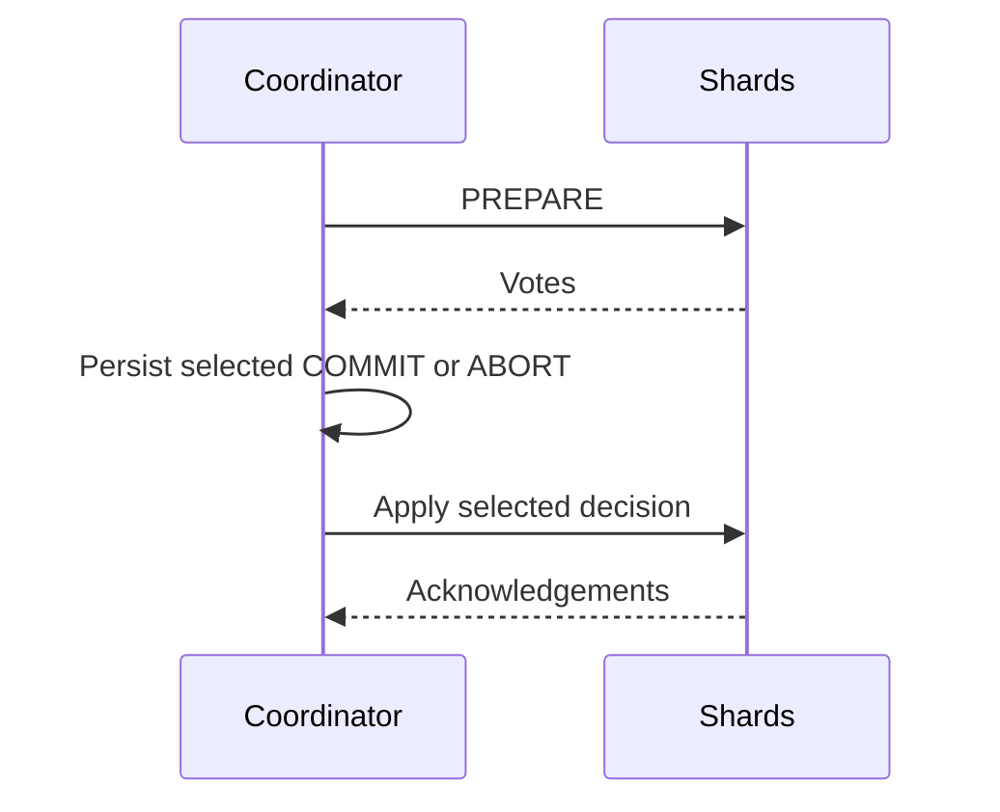

Exact model backend not verifiable from final document text alone.

# Sharding Module Architecture

## Kontext

`src/sharding/` owns partition topology, shard routing, distributed coordination/consensus adapters, cross-shard transaction orchestration, shard WAL integration, and migration/rebalance/repair operations. It does not own the underlying storage engine or the separate replication module's replica lifecycle.

## Komponenten

| Component | Public interface | Source-backed responsibility |
|---|---|---|
| Topology and routing | [`ShardRouter`](../../include/sharding/shard_router.h), [`ShardTopology`](../../include/sharding/shard_topology.h), [`AdaptiveShardRouter`](../../include/sharding/adaptive_shard_router.h) | Select routing strategy and address requests against configured shard topology. |
| Coordination | [`DistributedCoordinator`](../../include/sharding/distributed_coordinator.h), [`ConsensusFactory`](../../include/sharding/consensus_factory.h), [`QuorumManager`](../../include/sharding/quorum_manager.h) | Coordinate tasks and choose among the available consensus implementations. |
| Cross-shard transactions | [`CrossShardTransactionCoordinator`](../../include/sharding/cross_shard_transaction.h), [`TwoPhaseCommitCoordinator`](../../include/sharding/two_phase_commit_coordinator.h) | Preserve both public APIs while sharing coordinator-side 2PC phase ordering, decision durability gating, and failure outcomes through [`two_phase_commit_contract.h`](../../include/sharding/detail/two_phase_commit_contract.h). |
| Durability and operations | [`WALManager`](../../include/sharding/wal_manager.h), [`WALApplier`](../../include/sharding/wal_applier.h), [`AutoRebalancer`](../../include/sharding/auto_rebalancer.h), [`DataMigrator`](../../include/sharding/data_migrator.h) | Record/apply shard WAL state and manage rebalance/migration work. |

The source contains multiple consensus adapters (including Raft, Paxos, and Gossip); this architecture does not treat one adapter as the only supported implementation.

## Schnittstellen

`ShardRouter` addresses shard requests; `CrossShardTransactionCoordinator` and
`TwoPhaseCommitCoordinator` retain separate public lifecycles while sharing the
internal 2PC decision-ordering contract. Their transport and recovery APIs are
not interchangeable.

Both public APIs are retained. `TwoPhaseCommitCoordinator::commit()` is the standalone 2PC
entry point; `CrossShardTransactionCoordinator` delegates its 2PC prepare/decision/phase-two
ordering to the same internal execution contract while retaining its transaction lifecycle,
transport, SSI, and multi-protocol responsibilities. A prepare failure selects ABORT. The
configured decision-record callback must succeed before phase two; a phase-two acknowledgement
failure returns an error/in-doubt state and never changes the selected decision.
`CrossShardTransactionCoordinator` reports that state as `UNKNOWN`; the standalone coordinator
reports `ERROR` while retaining the selected decision in its recoverable view (durable replay
requires WAL to be configured). `TwoPhaseCommitCoordinator` can re-drive from its WAL when
configured. `CrossShardTransactionCoordinator::recoverFromWAL()` restores state and reports
resume candidates, but does not automatically re-drive phase-two RPCs; an `UNKNOWN` transaction
therefore requires external reconciliation.

The shared contract does **not** make the coordinators' WAL formats, snapshots, transaction-state
representations, or recovery replay interchangeable. DIS-05 covers only this named pair; the
separate DIS-06 recovery boundary remains open. `DistributedTransactionCoordinator`, declared in
`distributed_transaction.h`, is a third 2PC-capable public surface with its own transaction,
endpoint, and recovery paths; it is not part of this contract. No direct production instantiations
of the named pair were found in `src/` or `include/` during the DIS-05 source review.

## Datenfluss

1. A query/request is classified and routed using the current topology and routing policy.
2. Remote execution and shard-local operations return results/status to the routing/coordinator path.
3. Cross-shard transactions coordinate participant work; both DIS-05 2PC paths apply the shared prepare → configured decision record → phase-two contract, while each coordinator records its own WAL/state format. Standalone 2PC re-drives through its WAL when enabled; CrossShard recovery currently restores/reports resume candidates only.
4. Rebalance, migration, and repair components act on topology/health information and report operation state to their callers.

Evidence includes [`shard_router.cpp`](shard_router.cpp), [`cross_shard_transaction.cpp`](cross_shard_transaction.cpp), [`wal_manager.cpp`](wal_manager.cpp), and [`auto_rebalancer.cpp`](auto_rebalancer.cpp).

## Sequenz (kritischer Ablauf)

Kurzinterpretation: Phase two follows only after the configured decision record
succeeds; missing acknowledgements leave that decision unresolved.

## Fehlerpfade und Resilienz

- Invalid or empty topology and unavailable target shards prevent normal routing; remote execution errors are distinct from local planning errors.
- Quorum/consensus outcomes can prevent a coordination decision. An in-doubt transaction is a separate recovery state, not a confirmed commit.
- WAL persistence/replay errors affect shard state recovery; migration/rebalance conflicts can leave an operation incomplete and require the operation-specific recovery path.
- Timeouts, circuit breakers, and health monitors are component-specific; no universal automatic failover behavior is assumed.

## DIS-03: Routing- und Snapshot-Entwurf zur Maintainer-Abnahme

**Status: Vorschlag, nicht implementiert oder freigegeben.** Dieser Entwurf
ändert weder Hashverfahren noch Platzierung, RPC-Format oder Produktionswiring.
Storage- und Sharding-Maintainer müssen die unten genannten Entscheidungen
abnehmen; bis dahin bleiben automatischer Export und Ownership-Cutover gesperrt.
Die bestehenden [Transfer-APIs](API.md#shard-transfer-dis-03) liefern lediglich
verifiziertes, isoliertes Staging.

#### Typisierte Routing-Identität ohne impliziten Hashwechsel

Eine vorgeschlagene `RoutingKeyDescriptor`-Identität bindet Schlüsseltyp,
exakte Schlüsselbytes, Algorithmus-ID und Version an die persistierte
Placement-Konfiguration und dieselbe Topologie-Epoche wie die Assignment.
Routing, Export und Zielvalidierung verwenden dieselbe Identität; kein
automatischer Wechsel bei fehlender Bibliothek, unbekannter Version oder
unbekanntem Schlüsseltyp.

| Schlüsseltyp | Bestehende Abbildung | Vorgeschlagener expliziter Vertrag |
|---|---|---|
| Partition-Key | `ConsistentHashRing::getNode()` / `hashKey()`: FNV-1a und 64-Bit-Mix über die gelieferten Bytes | `partition-key/fnv1a-mix64-v1`; keine neue Namespace-Präfixierung, Unicode-Normalisierung oder andere Byteänderung |
| URN-UUID | `getShardForURN()` delegiert an `URN::hash()`: UUID-String, xxHash64 mit Seed 0 wenn verfügbar | `urn-uuid/xxh64-seed0-v1` nur für nachweislich damit angelegte Placements; Hashinput sind die bestehenden UUID-Stringbytes, nicht die gesamte URN oder binär dekodierte UUID |
| URN-UUID ohne xxHash | derzeit `std::hash<std::string>` | Kein portabler Algorithmusvertrag. Export abweisen, solange reproduzierbare Bestandsplatzierung und genehmigter Migrationspfad nicht nachgewiesen sind; keinen neuen Kompatibilitätsfallback hinzufügen |

Quelle: [`consistent_hash.cpp`](consistent_hash.cpp) und [`urn.cpp`](urn.cpp).
`URNResolver::getShardForKey()` ignoriert derzeit das Collection-Argument;
der Entwurf fügt es nicht heimlich zum Hashinput hinzu. Er vereinheitlicht den
Vertrag, nicht ungeprüft die bestehenden Tokenwerte. Eine Änderung des
Algorithmus oder der Schlüsselbytes braucht Inventarisierung der Bestände,
Vergleich alter/neuer Placement-Ergebnisse, explizite Umzugsentscheidung und
einen getrennten, gefenceten Rollout. Vor Cutover ist ein Abbruch möglich;
nach Cutover gilt die persistierte Authority-Entscheidung, kein automatischer
Rollback auf die alte Abbildung.

#### Exakte Ownership statt Min/Max-Hülle

Ein vorgeschlagenes unveränderliches `OwnershipSnapshot` bindet die tatsächlich
eingefügten Ringtokens und ihre Besitzer an eine Authority-Epoche und einen
Ring-Fingerprint. Für Ringtoken `t` mit Vorgänger `p` besitzt der bei `t`
eingetragene Shard das Segment **(p, t]** im Uhrzeigersinn; dies folgt aus
`getShardForHash()` mit `lower_bound`. Ein Token am Endpunkt gehört zum
Endpunktbesitzer, nicht zum nächsten Segment.

- Segmente eines Shards werden einzeln exportiert, niemals als Hülle aus
  `getShardRange()`; virtuelle Knoten können durch fremde Segmente getrennt sein.
- Wrap-around wird in zwei lineare Intervalle zerlegt. Für eine normalisierte
  halb-offene Darstellung wird `2^64` als eigener oberer Endmarker modelliert,
  nicht als überlaufender `uint64_t`. Das letzte Token bleibt darstellbar.
- Ein Ringtoken bedeutet Vollringbesitz; ein leerer Ring bedeutet keine
  autorisierte Ownership. Gleiche Grenzen bedeuten nicht implizit Vollring.
  Kollisionen richten sich nach den tatsächlich eingefügten Tokens, nicht
  nach einer nachträglich neu berechneten VNode-Liste.
- Jeder exportierte Schlüssel wird über seinen typisierten Token erneut gegen
  die exakten Segmente und den Quellbesitzer geprüft. Epochendrift sperrt
  Admission, Resume und Finalisierung.

Die heutige Transfer-Manifest-Range ist auf aufsteigende `uint64_t`-Grenzen
beschränkt. Mehrsegment-, Vollring- und oberste Token-Abbildung erfordern einen
explizit versionierten Manifestvertrag; das aktuelle Format wird nicht
stillschweigend umgedeutet.

#### Storage-eigener atomarer Snapshot

Ein vorgeschlagenes RAII-`RangeExportHandle` hält genau einen echten RocksDB-
Snapshot, dessen **eigene** Sequenznummer, den MVCC-HLC-Grenzwert und den
OwnershipSnapshot. Eine separat abgefragte neueste DB-Sequenz ersetzt nicht
die Sequenz des Snapshots. Schlüsselermittlung und Versionsauswahl müssen
dieselbe Snapshot-Sicht nutzen; kein `scanBaseKeys()` plus unabhängige
`getAtTimestamp()`-Reads.

Für die erste Freigabe zuerst alle Schreibpfade der Range wirksam sperren,
bereits laufende Transaktionen bis Commit/Abort drainen und den Fence bis zur
Ownership-Entscheidung halten. Erst danach werden Snapshot und Watermarks
aufgenommen. HLC allein beweist keine Commit-Sichtbarkeit:
`putInTxn()` vergibt Zeitstempel vor Commit. Ein vor dem Watermark
zeitgestempelter, erst nach Snapshotaufnahme committeter Datensatz darf
deshalb nicht nachträglich in den Export gelangen.

Die Assignment bindet Operation-ID und Migration-ID, beide Shards, Rollen,
Epoch und den Manifest-Fingerprint dauerhaft. X.509-Identität wird auf einen
Cluster-Principal abgebildet; nur dessen zugewiesene Rolle darf PREPARE,
Stream, Resume oder Abort ausführen. Cutover benötigt eine eigene Berechtigung.
Nach Source-Restart muss der Fence wiederhergestellt und die Assignment
revalidiert werden, bevor normale Range-Schreibzugriffe zugelassen werden;
eine Prozesssperre allein ist keine crashfeste Quieszenz.

Die Storage-Schnittstelle selektiert pro logischem Schlüssel die bei der
Snapshot-Sequenz committete neueste Version mit HLC kleiner/gleich dem
Grenzwert. Sie prüft Iteratorstatus, Storage-I/O, Cancellation und Ressourcen-
grenzen explizit; Fehler sind keine leere Range. Ein atomarer Iterator kann
eine konsistente Enumeration liefern, aber die aktuelle Kombination mehrerer
Scans/Einzelreads etabliert diesen Gesamtvertrag nicht.
GC-Pins schützen benötigte historische Versionen, ersetzen jedoch weder
Commit-Sichtbarkeit noch konsistente Enumeration. Snapshot, Pin und Sperre
brauchen eindeutige Ownership und Fehler-/Freigaberegeln.

Für Source-Restart-Resume wird der kanonische logische Export mitsamt Manifest
durabel abgeschlossen, bevor die Assignment ihn als resumierbar freigibt.
Ein Snapshot-Pointer oder HLC-Pin allein ist kein durabler Export. Falls kein
durabler Export verfügbar ist, muss nach Verlust des Handles eine frische
Assignment mit neuer Migration-ID angelegt werden. Eine verifizierte
Zielkopie aus einer alten Manifestidentität wird dadurch nicht automatisch
zur neuen Snapshot-Sicht.

#### Explizite Löschsemantik und isolierter Import

Ein vorgeschlagenes `LogicalSnapshotRecord` trägt einen expliziten Typ
`PUT` oder `DELETE`, Schlüsselbytes und Versionsmetadaten; ein leeres PUT
bleibt von DELETE unterscheidbar. Die heutige MVCC-Repräsentation verwendet
leere Werte als Tombstones. Der Adapter darf daraus keine nachträglich
erfundenen leeren Live-Werte rekonstruieren; Storage-Maintainer müssen
Bestandssemantik und gegebenenfalls Formatmigration festlegen.

Kanonische Reihenfolge ist byteweise nach logischem Schlüssel, ohne doppelte
Schlüssel, mit versionierter längenbasierter Kodierung einschließlich Typ und
Watermarks. Tombstones werden im abgeschlossenen logischen Snapshot bewahrt;
Import erfolgt in ein leeres, migrationseigenes Staging-Namespace, nicht als
Merge in bestehende sichtbare Daten. Sekundärindizes und weitere abgeleitete
Strukturen benötigen einen ausdrücklich abgenommenen Rebuild-/Importvertrag.
Der heutige Key/Value-Materializer kodiert keinen Record-Typ und darf nicht
als Implementierung dieses neuen Formats ausgegeben werden.

#### Freigabereihenfolge und Human-Abnahme

1. **Routing-Kompatibilität:** Schlüsseltyp/Algorithmus/Bytes pro Placement
   inventarisieren; feste Tokenvektoren und plattformübergreifende Ergebnisse
   abnehmen. Kein Hash-/Placementwechsel ohne genehmigten Datenumzug.
2. **Ownership:** für jeden Grenztoken Gleichheit zur tatsächlichen Ringroute,
   VNode-Lücken, Token 0/Maximum, Wrap-around, Vollring und leeren Ring beweisen.
3. **Snapshot:** reale Storage-Tests für atomare Enumeration, konkurrierende
   Commits, GC, Tombstones, Restart und fehlerhaftes/abgebrochenes I/O.
4. **Transport:** Zwei-Prozess-mTLS mit nichtleerer Range, persistierten
   Zielrecords nach Restart, Resume, identischem/konfligierendem Replay,
   falscher Identität/Epoche, Checksumfehler und durablem Abort.
5. **Cutover:** gesondertes HA-Gate für wirksame Quieszenz, dauerhaft atomare
   Authority-Entscheidung, Publikation nur nach dieser Entscheidung und
   Reconciliation nach verlorener Bestätigung. Ein Transport-PASS ist kein
   HA-PASS; alle Pre-Cutover-Fehler lassen die Quelle autoritativ.

Abnahme ausstehend: Sharding-Maintainer (typisierte Placement-Identität,
Segmente, Manifestversion), Storage-Maintainer (Snapshot, Tombstones,
durabler Export, abgeleitete Strukturen) und Cluster/Operations-Maintainer
(Assignments, Quieszenz, Authority und Restart-Recovery). Diese Rollen sind
Review-Zuständigkeiten, keine behaupteten Unterschriften.

## Nicht-Ziele

- Owning record persistence, RocksDB internals, or general backup/PITR.
- Owning replication-manager membership and WAL-to-replica delivery.
- Query-language parsing or client transport protocol handling.
- Assuming every configured consensus backend, cloud adapter, or optional hardware path is enabled.

## Verweise

| Boundary | Evidence and link |
|---|---|
| Query federation | `query_federation.cpp` requires a `sharding::ShardRouter`; see [query architecture](../query/ARCHITECTURE.md). |
| Storage WAL | `wal_manager.cpp` includes `storage/wal_storage.h`; see [storage architecture](../storage/ARCHITECTURE.md). |
| Replication separation | Replication and sharding have separate public contracts; see [replication architecture](../replication/ARCHITECTURE.md). |

- [Module README](README.md) · [API notes](API.md) · [module roadmap](ROADMAP.md)
- [`sharding_api_contract.h`](../../include/sharding/sharding_api_contract.h) · [`shard_router.h`](../../include/sharding/shard_router.h) · [`cross_shard_transaction.h`](../../include/sharding/cross_shard_transaction.h)
