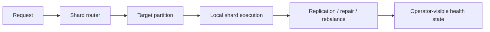

> Exact model backend not verifiable from final document text alone.
>
> Capabilities below describe code surfaces, not a guarantee that every deployment enables each
> backend or achieves the stated operational outcome. **TODO:** attach configuration/test evidence
> before making deployment-specific availability or performance claims.

# Sharding in ThemisDB

As data volumes grow, a single node or a single storage path becomes the bottleneck. Sharding solves that by partitioning data and workload across multiple nodes so the system can scale horizontally without turning every request into a global bottleneck. In ThemisDB, the sharding module is the part that decides where data lives, how requests are routed, and how the platform behaves when topology changes or a node becomes unavailable.

The general challenge is not only capacity, but controlled scale-out. A distributed database can grow in size without becoming easier to operate if partitions are poorly placed, routing is unstable, or rebalance events create hidden inconsistency. ThemisDB addresses this with routing logic, placement policies, replication coordination, and repair/rebalance behavior so that scale-out remains predictable instead of chaotic. That is what makes sharding a system-level control plane, not just a storage optimization.

This module is central to large-scale deployment patterns. It connects the storage and replication layers to the actual runtime topology and is where a single-node architecture becomes a coherent distributed system. The local contract in [README.md](./README.md) and the architecture context in [ARCHITECTURE.md](./ARCHITECTURE.md) make that clear, and the broader systems narrative in [docs/compendium/docs/index.md](./../../docs/compendium/docs/index.md) provides useful cross-platform grounding for topology and load behavior.

The first core capability is placement and routing. Requests must be sent to the correct shard based on key, policy, and current topology. This is the most visible sharding feature from a developer and operator perspective, because it determines whether the database remains fast and predictable under load and whether request paths remain stable as the cluster evolves. Without consistent routing, operators cannot reason about capacity or latency in a meaningful way.

The second core capability is controlled rebalancing and repair. Data is not static forever. As nodes are added, removed, or rebalanced, ThemisDB must move data and adjust routing without creating inconsistent behavior or long periods of degraded service. The sharding model therefore includes data migration, repair, and rebalancing logic so that scale changes do not silently undermine correctness or base availability.

The third core capability is distributed coordination and resilience. Sharding is not just about dividing data; it also defines behavior under partial outages, topology drift, or cross-shard transaction requirements. The module includes health checks, routing state awareness, and fail-closed behaviors so degraded or inconsistent states become explicit and diagnosable rather than quietly incorrect.

For customers and operators, the value is operationally significant: more scale, better workload isolation, and a clearer path to resilience as the system grows. A well-designed sharding strategy helps avoid hotspots, supports larger datasets, and keeps cluster maintenance manageable. It also reduces operational risk by making routing and repair behavior explicit instead of hidden inside ad hoc assumptions. In real deployment settings, this translates into more predictable performance under growth and a lower chance that a topology change creates a user-visible outage.

ThemisDB keeps this boundary clear: sharding owns partitioning, routing, coordination, repair, and topology-aware runtime behavior, while storage, query execution, and network transport remain separate concerns. That separation is important because distributed infrastructure is only manageable when failure domains are visible and responsibility remains explicit. In other words, sharding is not merely a storage layout feature; it is a platform scaling and resilience mechanism.

The source basis for this page is primarily module-local and then checked against the wider systems context: [README.md](./README.md), [ARCHITECTURE.md](./ARCHITECTURE.md), [ROADMAP.md](./ROADMAP.md), [FUTURE_ENHANCEMENTS.md](./FUTURE_ENHANCEMENTS.md), [PRODUCTION_REQUIREMENTS.md](./PRODUCTION_REQUIREMENTS.md), and [docs/compendium/docs/index.md](./../../docs/compendium/docs/index.md). These references help explain sharding as a platform-scale design principle without overstating claims beyond the verified module footprint.
