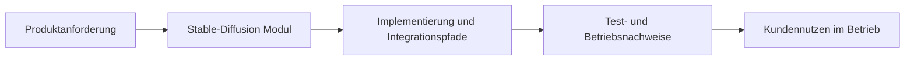

> Exact model backend not verifiable from final document text alone.

# Stable-Diffusion in ThemisDB

## Ueberblick
Implements text-to-image generation for ThemisDB. Provides an `IImageGenerationBackend` implementation (`SDPlugin`) with configurable keyword filtering and optional [stable-diffusion.cpp](https://github.com/leejet/stable-diffusion.cpp) inference when enabled and linked. Stub mode does not require that backend library or a model file. Keyword filtering is not comprehensive content moderation or a safety guarantee. Im Modulkontext werden Aussagen mit [Architekturgrenzen](./ARCHITECTURE.md), [Release-Planung](./ROADMAP.md), [Produktionsanforderungen](./PRODUCTION_REQUIREMENTS.md) abgeglichen. Im Betrieb sind dabei insbesondere [Latenz](https://en.wikipedia.org/wiki/Latency_(engineering)), [Observability](https://en.wikipedia.org/wiki/Observability) und [Determinismus](https://en.wikipedia.org/wiki/Deterministic_algorithm) relevante Qualitaetskriterien. Fuer Querschnittskontext wird das Modul mit den relevanten Stellen im [Compendium](./../../docs/compendium/docs/index.md) verknuepft.

## Kern-Features im Detail
Die erste Kernfaehigkeit ist **IImageGenerationBackend, GeneratedImage, SDGenerationConfig**. Das beschreibt einen konkreten, in den Modulquellen referenzierten Verantwortungsbereich.

Die zweite Kernfaehigkeit ist **SDPlugin (top-level)**. Dadurch bleiben Integrationspfade zwischen Modulgrenzen reproduzierbar und operativ auswertbar.

Die dritte Kernfaehigkeit ist **ISDGenerator, SDStubGenerator, InMemorySDGenerator**. Das unterstuetzt stabile Abnahme- und Aenderungsprozesse entlang der Modul-Roadmap.

## Kundennutzen und Abgrenzung
**Annahmen, keine gemessenen Betriebsergebnisse:** Das Modul kann zu besser planbarem
Systemverhalten, kuerzeren Eingrenzungszeiten bei Stoerungen und transparenteren Release-Risiken
beitragen. Diese Seite ist ein fachlich-kommunikativer Ueberblick; normative API-, Compliance-
und Freigabeaussagen verbleiben in den kanonischen Modulquellen.

## Einordnung und Quellen
Primaere modulnahe Quellen: [README.md](./README.md), [ARCHITECTURE.md](./ARCHITECTURE.md), [ROADMAP.md](./ROADMAP.md), [FUTURE_ENHANCEMENTS.md](./FUTURE_ENHANCEMENTS.md), [PRODUCTION_REQUIREMENTS.md](./PRODUCTION_REQUIREMENTS.md), [SECURITY.md](./SECURITY.md). Sekundaere Querschnittsquellen: [docs/stable_diffusion/README.md](./../../docs/stable_diffusion/README.md), [Compendium Index](./../../docs/compendium/docs/index.md). Aussagen wurden auf diese Quellenbasis begrenzt; bei fehlenden Modulquellen werden keine weitergehenden Produktclaims ergänzt.
