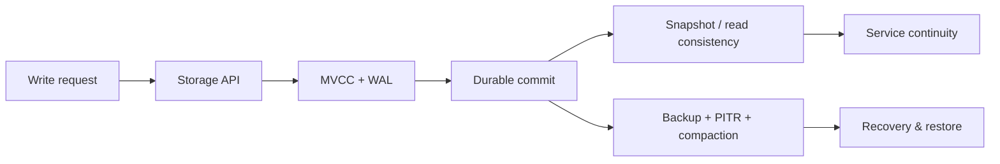

# Storage in ThemisDB

Storage is the foundation of every durable database. If write durability, crash recovery, or data consistency are weak, every higher layer becomes unreliable. In ThemisDB, the storage module is therefore more than a persistence wrapper: it is the operational backbone for correctness, recovery, and trust.

The general idea is straightforward. Data must be written safely, survive crashes, remain readable in the correct version, and be recoverable to a known point in time. ThemisDB turns this into concrete storage capabilities: [MVCC](https://en.wikipedia.org/wiki/Multiversion_concurrency_control), [write-ahead logging](https://en.wikipedia.org/wiki/Write-ahead_logging), durable replay, backup and [point-in-time recovery](https://en.wikipedia.org/wiki/Point-in-time_recovery), and tiered storage policies that move data between hot and cold layers without breaking service semantics. These are not abstract architecture goals; they are the reason production systems can keep running after outages, compaction cycles, or partial failures.

The storage layer is built around the principle that correctness must be explicit. A write is only valuable if it can be recovered reliably, audited cleanly, and interpreted consistently across snapshots. That is why the module includes strict durability and recovery paths alongside the storage APIs in [README.md](./README.md) and the architecture guidance in [ARCHITECTURE.md](./ARCHITECTURE.md). The design is also aligned to the deeper operational background in the storage chapter of the [compendium](./../../docs/compendium/docs/chapter_08_storage_layer.md), which explains the RocksDB and LSM foundations behind the runtime behavior.

The first core capability is durable write throughput with explicit recovery semantics. Every committed write is protected by a safe persistence path, and the system can replay or recover the state after restart or partial failure. This is the basis for trustworthy production behavior: users, operators, and downstream services can rely on the database not silently dropping acknowledged writes.

The second core capability is snapshot-safe versioning through MVCC. Instead of overwriting the most recent state in place, the system keeps the necessary version history so readers can see a consistent view while writers continue. This matters for concurrency, analytics, and operational safety, because it prevents torn reads and maintains stable data boundaries during active writes and compaction.

The third core capability is operational recovery and lifecycle control: backups, PITR, compaction, and tiered storage. These features determine whether a system can be restored quickly after corruption, misconfiguration, or an operational error. A storage layer that can restore to a known point in time and move data between layers without violating read guarantees is materially more valuable than one that only stores bytes.

For customers and operators, this translates into predictable uptime, less risk from crashes, and faster incident containment. A durable storage layer reduces the chance that a restart turns into data loss or inconsistent state, while backups and PITR shrink recovery time to minutes instead of hours. Operationally, it improves system trust: the database remains a reliable substrate for analytics, application data, and AI workloads built on top of it.

ThemisDB makes this explicit in its module boundaries: the storage layer owns persistence integrity, durable lifecycle behavior, and recovery semantics; it does not absorb query planning or network transport concerns, which remain in their own subsystems. That separation keeps responsibilities clear and aligns product promises with implementation reality.

The source basis for this page is primarily module-local and then cross-checked against the deeper operational narratives: [README.md](./README.md), [ARCHITECTURE.md](./ARCHITECTURE.md), [ROADMAP.md](./ROADMAP.md), [FUTURE_ENHANCEMENTS.md](./FUTURE_ENHANCEMENTS.md), [PRODUCTION_REQUIREMENTS.md](./PRODUCTION_REQUIREMENTS.md), and [chapter_08_storage_layer.md](./../../docs/compendium/docs/chapter_08_storage_layer.md). These sources provide the concrete operational frame for the storage product story without overstating claims beyond the repository's verified contract. 
