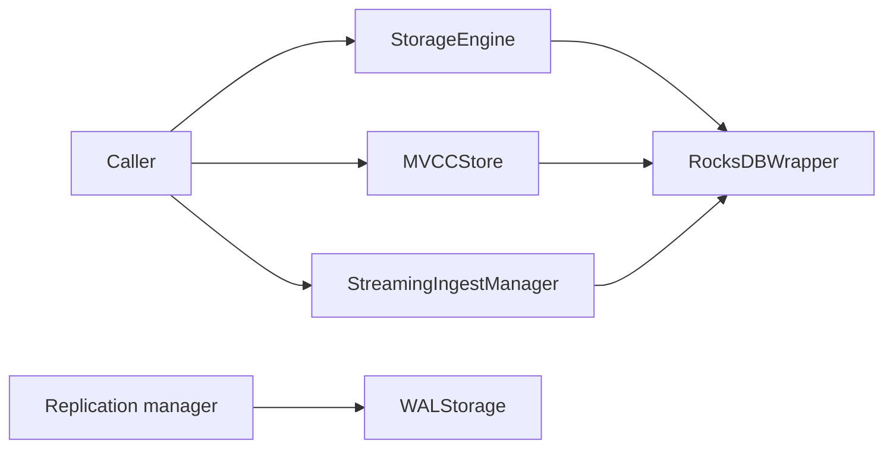

Exact model backend not verifiable from final document text alone.

# Storage module

## Zweck

The storage source tree contains several related but distinct components. This
overview makes no module-wide durability, ACID, recovery-time, or availability
claim; those depend on the component, configuration, backend, and caller.

## Scope

The module covers the storage engine and RocksDB wrapper, versioned storage,
WAL facilities, and separate backup, blob, tiering, and maintenance components.
See the [component interfaces](ARCHITECTURE.md#components-and-public-interfaces).

## Quickstart (Build/Run)

From the repository root, configure a build as described in
[`SETUP.md`](../../SETUP.md), with `-DTHEMIS_BUILD_TESTS=ON` (some presets
disable tests). For an existing configured build directory, build and run the
focused WAL test registered in
[`tests/CMakeLists.txt`](../../tests/CMakeLists.txt):

```sh
cmake --build <build-dir> --config Release --target test_wal_storage_focused
ctest --test-dir <build-dir> -C Release -R "^WALStorageFocusedTests$" --output-on-failure
```

Replace `<build-dir>` with the configured directory and `Release` with its
configuration. Registration is not evidence that the test has been executed.

## API/CLI Einstieg

Start with [`storage_engine.h`](../../include/storage/storage_engine.h) for
`StorageEngine`, or the [API contract](API.md) for the separate MVCC, WAL, and
ingest interfaces. Callers must inspect returned errors; `createDefault()` uses
development/test dependencies, not a production configuration.

## Integrationsueberblick



**Interpretation:** These are separate integration surfaces, not a single
mandatory write pipeline: the engine, MVCC store, and ingest manager use a
RocksDB wrapper, while replication uses the separate WAL API. See
[`storage_engine.cpp`](storage_engine.cpp), [`mvcc_store.cpp`](mvcc_store.cpp),
[`streaming_ingest_manager.cpp`](streaming_ingest_manager.cpp), and
[`replication_manager.cpp`](../replication/replication_manager.cpp).

## Component map

- `StorageEngine` provides `open`, `close`, `put`, `get`, `del`, and callback
  scans over its `RocksDBWrapper`. Its default dependency implementations are
  development/test shims; production-mode checks are implemented in
  `storage_engine.cpp`.
- `MVCCStore` stores HLC-versioned keys in a supplied, already-open
  `RocksDBWrapper`. It exposes latest and timestamp-relative reads, history
  scans, and version garbage collection. It is not automatically the same write
  path as `StorageEngine`.
- `WALStorage` is a separate append/replay/checkpoint API. Its configured
  `fsync_on_write` policy affects sync behavior; this API must not be conflated
  with RocksDB's internal WAL or assumed to wrap every `StorageEngine` write.
- `WALStorage::open()` can report `Complete`, `TruncatedTail`, `Corrupted`,
  `TimedOut`, or `Failed` through its optional `RecoveryResult` output. Strict
  recovery is the default; the configurable millisecond timeout is unlimited
  at zero and rejects negative values. Progress observers receive synchronous
  per-record snapshots and a terminal status; reports include replay counters,
  segment, elapsed time, and error detail. Explicit `SkipCorrupted` quarantines a corrupt
  segment under `<wal_dir>/quarantine`; callback aborts and I/O errors fail
  open. These source-level behaviors do not establish crash-harness or benchmark
  evidence.
- `StreamingIngestManager::ingestBatch()` admits all events or none: BLOCK
  waits for full-batch capacity and times out without enqueueing; DROP returns
  zero and drops the entire batch if capacity is insufficient. Flush uses
  atomic RocksDB WriteBatch chunks; failed chunks and the remaining suffix are
  retained ahead of newer events for ordered, PUT-idempotent retry.
- Backup, PITR, blob, tiering, maintenance, integrity, and diagnostics
  components have their own interfaces and configuration. Their presence does
  not establish an end-to-end guarantee for every deployment.

## Known Limitations

- A WAL operation reports errors through `Result`; `fsync_on_write` defaults
  to true but is configurable. See [`API.md`](API.md) and
  [`IMPLEMENTATION.md`](IMPLEMENTATION.md).
- A corrupted final-frame length can appear to be an incomplete WAL tail and
  be truncated before CRC verification; this case is not fail-closed. See
  [`wal_storage.h`](../../include/storage/wal_storage.h) and the
  [recovery limitation](API.md#known-recovery-limitation).
- MVCC timestamp reads and the WAL's recovery callback are separate contracts;
  neither implies a transaction-isolation or recovery guarantee for all module
  components.
- The tiered-storage header declares a local three-tier manager and migration
  controls. Its declarations do not establish measured latency or universal
  non-blocking behavior.
- `EncryptedBlobBackend` encrypts data routed through that decorator only. It
  does not imply encryption of RocksDB, WAL, backup, or audit files.
- The source and test registration maps are in
  [`ARCHITECTURE.md`](ARCHITECTURE.md),
  [`tests/storage/CMakeLists.txt`](../../tests/storage/CMakeLists.txt), and
  [`benchmarks/storage/CMakeLists.txt`](../../benchmarks/storage/CMakeLists.txt).

## Verweise

- [`API.md`](API.md) — caller-facing contracts
- [`IMPLEMENTATION.md`](IMPLEMENTATION.md) — source boundaries and validation
- [`OPERATIONS.md`](OPERATIONS.md) — operational signals and limitations
- [`RUNBOOK.md`](RUNBOOK.md) — operational troubleshooting; verify recovery
  actions against the deployment
- [`ROADMAP.md`](ROADMAP.md) — module planning and evidence status
- [`SECURITY.md`](SECURITY.md) and [`TRUST.md`](TRUST.md) — security boundaries
