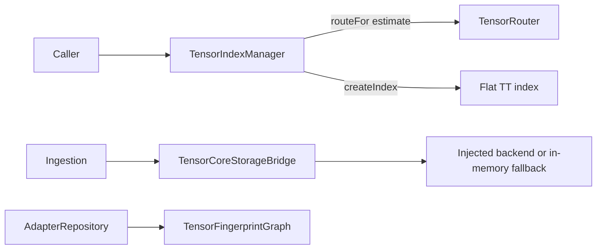

> Exact model backend not verifiable from final document text alone.

# ThemisDB Tensor Module

<!-- Status: current | validated: 2026-10-31 -->
<!-- Links: ARCHITECTURE.md · ROADMAP.md · FUTURE_ENHANCEMENTS.md · THEMIS_BRAIN_MEMORY_COMPARATIVE_PAPER.md -->

## Zweck

The tensor module provides tensor-aware indexing, retrieval, and graph/fingerprint behavior for ThemisDB, including tensor index management, tensor fingerprint graph operations, and tensor deduplication-related behavior.

## Scope

In scope:
- tensor-aware indexing and retrieval behavior
- tensor fingerprint graph and dedup-related runtime behavior
- tensor bridges, ingestion, and structural helper behavior

Out of scope:
- non-tensor ANN internals owned by other modules
- external model-serving orchestration outside tensor boundaries

## Quickstart (Build/Run)

This is an in-tree module guide; use the main ThemisDB build configuration rather
than treating `themis_tensor` as a separately packaged installation.

The module is a C++17 static library target. From an existing configured build directory:

```sh
cmake --build <build-dir> --target themis_tensor
cmake --build <build-dir> --target module_tensor_test_tensor_contract_hardening_focused
ctest --test-dir <build-dir> -L tensor --output-on-failure
```

Module tests are discovered from `tests/tensor/test_*.cpp`; the focused CTest name is
`<source-stem>_tensor_FocusedTests`. The stress target has a 300-second timeout.
Tensor benchmarks are discovered from `benchmarks/tensor/bench_*.cpp` only when
`THEMIS_BUILD_BENCHMARKS` is enabled. CMake registration is not evidence that a
test or benchmark has built or passed.

## API/CLI Einstieg

The module exposes C++ interfaces and no standalone CLI. Include the relevant
public header from `include/tensor/` and follow its current contract.

| Interface / File | Role |
|---|---|
| tensor_index.cpp | tensor index behavior |
| tensor_index_manager.cpp | tensor index lifecycle and routing behavior |
| tensor_core_bridge.cpp | tensor core bridge behavior |
| tensor_ingestion_bridge.cpp | tensor ingestion bridge behavior |
| tensor_mmap_bridge.cpp | tensor mmap bridge behavior |
| hnsw_tt_bridge.cpp | hybrid HNSW-TT bridge behavior |
| ht_index.cpp | hierarchical tensor index behavior |
| tensor_fingerprint_graph.cpp | tensor fingerprint graph behavior |
| dream_orchestrator.cpp | Dream-Mode lifecycle and unified validation reports |
| adapter_repository.cpp | tensor adapter repository behavior |
| hyper_index_builder.cpp | tensor hyper-index builder behavior |
| hiss_structural_search.cpp | structural search behavior for tensor data |
| tnsr_task.cpp | tensor network structural task behavior |
| utr_converter.cpp | UTR conversion behavior |
| tensor_butterfly_operator.cpp | tensor butterfly operator behavior |

The [public header inventory](../../include/tensor/README.md) and
[API notes](./API.md) identify runtime behavior and known discrepancies.

## Integrationsueberblick



**Kurzinterpretation:** `routeFor()` returns an estimate that `createIndex()`
does not apply. The diagram shows separate runtime paths; it does not imply a
single end-to-end pipeline or durable storage when no backend is injected.

`DreamOrchestrator` aggregates utility, nonregression, ethics, isolation, label,
and security evidence into a schema-versioned report keyed by `run_id`. It
consumes evidence supplied by its caller rather than invoking the evaluation,
ethics, or security checkers itself. Reports are retained in the orchestrator's
in-memory store only; missing evidence remains `hold`, and reports do not survive
process restart.

## Known Limitations

- `TensorIndexManager::routeFor()` derives a `TensorRouter::DataProfile` from the dimension and vector count, estimates compressibility from dimension, and returns a route. The current `createIndex()` implementation creates a flat TT index without consuming that route; see [API contract caveat](./API.md).
- fingerprint graph behavior remains explicit and observable under insert/query/export operations.
- `findSimilar()` ranks registered TT trains using TT inner products; `findSimilarByFingerprint()` scans matching entries using approximate cosine similarity with zero-padding for unequal fingerprint lengths. Neither path uses LSH in the current implementation.
- `TensorCoreStorageBridge` uses an injected storage backend or registered factory; without either, it falls back to `InMemoryTensorBackend` and does not persist across process restarts.
- `TensorIndexManager::mapCores()` defaults to anonymous mapped memory populated by copying TT core data. File-backed `MAP_SHARED` mapping is a separate `buildFromFd()`/injected-mapper path, not the manager's default.

The root configuration registers `themis_tensor` before tests and benchmarks,
independently of `THEMIS_BUILD_ENTERPRISE_PLUGINS`. Tensor test registration
can therefore use the module target instead of its missing-target source
fallback. When `themis_core` or `themis_storage` is a static library that
already compiles tensor sources, `themis_tensor` omits those sources and links
the owner privately (`THEMIS_TENSOR_DEDUP_OWNER_SOURCES`, default `ON`; set
`OFF` to restore the previous full source list). Shared owners are eligible
when their symbols are exported: Windows auto-export must be enabled, and
other platforms must not use hidden C++ visibility. Test-specific direct
source additions are filtered against the same eligible owners. No configure,
build, or tests were run for these changes.

## Verweise

- [Architecture](./ARCHITECTURE.md) · [Roadmap](./ROADMAP.md) ·
  [Future enhancements](./FUTURE_ENHANCEMENTS.md) · [API notes](./API.md)
- [Public tensor header inventory](../../include/tensor/README.md)
- Build, test, and implementation evidence is summarized below and in the
  linked module documents.

## Sourcecode Verification (Module: tensor/readme)

- Verified files:
  - src/tensor/tensor_index.cpp
  - src/tensor/tensor_index_manager.cpp
  - src/tensor/tensor_core_bridge.cpp
  - src/tensor/tensor_ingestion_bridge.cpp
  - src/tensor/tensor_mmap_bridge.cpp
  - src/tensor/hnsw_tt_bridge.cpp
  - src/tensor/ht_index.cpp
  - src/tensor/tensor_fingerprint_graph.cpp
  - src/tensor/adapter_repository.cpp
  - src/tensor/hyper_index_builder.cpp
  - src/tensor/hiss_structural_search.cpp
  - src/tensor/tnsr_task.cpp
  - src/tensor/utr_converter.cpp
  - src/tensor/tensor_butterfly_operator.cpp
- Verified behavior surfaces:
  - tensor indexing/bridge/fingerprint/dedup-oriented runtime paths
- Note:
  - forward planning is tracked in ROADMAP.md and FUTURE_ENHANCEMENTS.md
  - historical entries remain in CHANGELOG.md