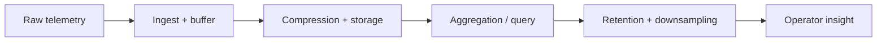

# Timeseries in ThemisDB

High-frequency data is a different class of problem than ordinary key-value records. Metrics, event streams, sensor readings, and operational telemetry arrive continuously and grow quickly, so the system must optimize not only for correctness but also for ingest rate, compression, retention, and time-window queries. In ThemisDB, the timeseries module handles exactly that challenge.

The general problem is simple: time-oriented data is usually append-heavy, query-heavy, and retention-sensitive. A good timeseries engine must ingest high-volume points efficiently, compress them without losing analytical fidelity, keep queries fast across time windows, and retain only the data that remains operationally valuable. ThemisDB builds this into a dedicated module with ingestion, storage, query, retention, downsampling, and compression behavior.

This makes the module highly relevant for monitoring, telemetry, infrastructure intelligence, and operational analytics. It is not just an isolated data structure; it is a core capability for systems that need to observe and reason about change over time. The local documentation in [README.md](./README.md), [ARCHITECTURE.md](./ARCHITECTURE.md), and the wider platform framing in [docs/compendium/docs/index.md](./../../docs/compendium/docs/index.md) place the module at the intersection of storage, observability, and operational analysis.

The first core capability is high-volume ingestion. Modern telemetry workloads can generate bursts of data far beyond what a generic transactional path is designed to handle efficiently. The timeseries layer therefore optimizes how data is written, buffered, and flushed so that write pressure remains manageable without sacrificing accuracy or queryability.

The second core capability is efficient compression and storage. Time-series data tends to contain repeating patterns and highly structured values, which makes it ideal for compact representations. ThemisDB uses techniques such as delta encoding and compressed point storage to keep footprint low while maintaining enough fidelity for analytic queries. This matters because storage cost and query performance are tightly coupled in high-frequency systems: if the data footprint grows too quickly, both cost and latency rise together.

The third core capability is retention and time-window analysis. Data is not kept forever in every workload, and not every query needs the same granularity. The timeseries module supports retention policies, downsampling, aggregation, and efficient time-range lookups so that operators can keep the most important historical signal without exploding cost or query latency. This is essential when teams need to understand immediate spikes, long-term drift, and incident windows without paying the full cost of raw memory or storage retention for all data.

For customers and operators, the practical value is clear: better monitoring, shorter diagnostics, lower cost for high-frequency telemetry, and faster insight into operational trends. A timeseries engine helps teams move from raw event volume to actionable understanding: trends, anomalies, baseline changes, and incident windows all become visible in a structured way. This is especially important for AI-assisted operations, infrastructure monitoring, security events, and large-scale system health analysis.

ThemisDB keeps the boundary precise: the timeseries module owns ingest, compression, retention, aggregation, and query semantics for time-oriented workloads, while lower-level persistence and more general query logic remain in their own modules. That separation is useful because time-series workloads have very different bottlenecks from transactional or graph workloads and deserve a dedicated operational model.

The value of a mature timeseries layer is not only technical but operational. It allows teams to answer questions such as: what changed over the last hour, what has drifted over the last week, and what was anomalous during the incident window? Those are exactly the questions that matter when operators are diagnosing service health, capacity usage, or business-relevant events over time. In that sense, timeseries is not merely a storage feature; it is a decision-support capability for platform operations.

The source basis for this page is primarily module-local and then aligned with the wider platform context: [README.md](./README.md), [ARCHITECTURE.md](./ARCHITECTURE.md), [ROADMAP.md](./ROADMAP.md), [FUTURE_ENHANCEMENTS.md](./FUTURE_ENHANCEMENTS.md), [PRODUCTION_REQUIREMENTS.md](./PRODUCTION_REQUIREMENTS.md), and [docs/compendium/docs/index.md](./../../docs/compendium/docs/index.md). These references provide the product-facing explanation without overstating implementation claims beyond the module contract.
