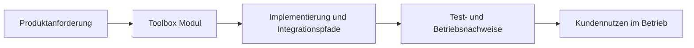

# Toolbox in ThemisDB

## Ueberblick
Das Modul toolbox stellt shared text-processing, extraction, chunking, normalization, quality, language, fingerprinting, and orchestration bridge behavior for ingestion-facing ThemisDB workflows. Im Modulkontext werden Aussagen mit [Architekturgrenzen](./ARCHITECTURE.md), [Release-Planung](./ROADMAP.md), [Produktionsanforderungen](./PRODUCTION_REQUIREMENTS.md) abgeglichen. Im Betrieb sind dabei insbesondere [Latenz](https://en.wikipedia.org/wiki/Latency_(engineering)), [Observability](https://en.wikipedia.org/wiki/Observability) und [Determinismus](https://en.wikipedia.org/wiki/Deterministic_algorithm) relevante Qualitaetskriterien. Fuer Querschnittskontext wird das Modul mit den relevanten Stellen im [Compendium](./../../docs/compendium/docs/index.md) verknuepft.

## Kern-Features im Detail

- **Workflow orchestration:** `IngestionToolbox` invokes the configured ingestion workflow and returns nodes or a complete entity set.
- **Construction:** `ToolboxBuilder` configures workflow dependencies, profiles, backends, extractors, and optional sinks/bridges.
- **Content bridge:** `ContentToolboxBridge` submits raw content to `ContentManager`, then enriches assembled text and may write results to optional graph/vector sinks.
- **Text helpers:** chunking, normalization, quality heuristics, English/German stopword detection, and SHA-256 fingerprinting are exposed through public headers.

## Kundennutzen und Abgrenzung

These capabilities may support integration and diagnosis in a host service, but this page makes no performance, compliance, availability, or release-readiness promise. Workflow results and optional sink durability depend on caller configuration and the owning subsystems. Normative API and security statements remain in the headers and linked module documentation.

## Einordnung und Quellen
Primaere modulnahe Quellen: [README.md](./README.md), [ARCHITECTURE.md](./ARCHITECTURE.md), [ROADMAP.md](./ROADMAP.md), [FUTURE_ENHANCEMENTS.md](./FUTURE_ENHANCEMENTS.md), [PRODUCTION_REQUIREMENTS.md](./PRODUCTION_REQUIREMENTS.md), [SECURITY.md](./SECURITY.md). Sekundaere Querschnittsquellen: [docs/toolbox/README.md](./../../docs/toolbox/README.md), [Compendium Index](./../../docs/compendium/docs/index.md). Aussagen wurden auf diese Quellenbasis begrenzt; bei fehlenden Modulquellen werden keine weitergehenden Produktclaims ergänzt.

> Exact model backend not verifiable from final document text alone.
