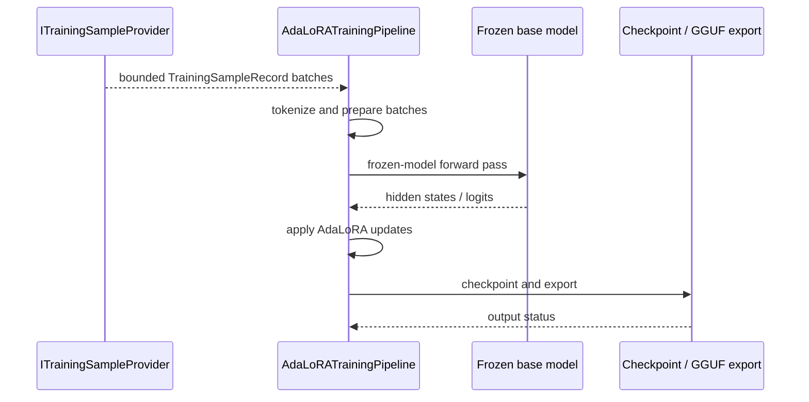

Exact model backend not verifiable from final document text alone.

# Architecture - Training Module

<!-- Status: current | source paths and dataflow reviewed: 2026-10-31 -->
<!-- Links: README.md · ROADMAP.md · FUTURE_ENHANCEMENTS.md -->

## Kontext

The training module composes auto-labeling and enrichment behavior, LoRA/AdaLoRA training lifecycle behavior, checkpoint/provenance handling, and training-pipeline orchestration into a bounded subsystem.

## Komponenten

1. Dataset preparation plane
- auto-labeling, domain labeling, modality parsing, and graph enrichment behavior

2. Adapter training plane
- LoRA/AdaLoRA adapter, merge, checkpoint, and serving-handoff behavior

3. Governance and orchestration plane
- provenance tracking, data selection, and end-to-end training pipeline behavior

## Datenfluss

- Prepared input paths: AQL built-in samples, custom/in-memory samples, JSON import, and `TrainingData` batch composition.
- DB-backed paths: `LegalAutoLabeler` reads a source collection through an injected `QueryEngine`; generated samples are persisted to the configured target collection; `IncrementalLoRATrainer` reads bounded, validated samples from that collection; `TrainingDataIterator` executes AQL and yields batches.
- AdaLoRA provider/consumer path: `ITrainingSampleProvider` normalizes source-specific records into bounded `TrainingSampleRecord` batches. `AqlTrainingSampleProvider` adapts `TrainingDataIterator` for authorized collections. `DocsDbTrainingSampleProvider` opens generated RocksDB read-only, prefers full `chunk_` records, and falls back to legacy `doc_` previews. `AdaLoRATrainingPipeline::trainFromProvider()` is the source-neutral consumer and owns tokenization, frozen-model forward passes, AdaLoRA updates, checkpoints, and GGUF export.
- Selection-to-training path: `TrainingPipeline` passes selected sample IDs to `IncrementalLoRATrainer::trainSelected()`. The DB query filters `_key` against the requested IDs before applying a limit equal to the unique selected-ID count. Empty, duplicate, or missing IDs and records with invalid/empty input or output fail closed; this path does not fall back to collection-wide or synthetic training.
- End-to-end path: `TrainingPipeline` wires the same `QueryEngine` through labeling, sample persistence, selection, and training; stage timings remain observable independently.
- Data-source timings are reported separately from LoRA updates; DB failures never count as a successful DB-backed run.
- The benchmark covers preparation-only and DB-backed CPU paths without a model artifact. Actual model-backed LoRA cases require a real GGUF and remain unmeasured when the preflight cannot find one.

The provider boundary does not grant data access: callers must authorize a source
before use. The docs.db adapter is not a docs-specific trainer; it only translates
the repository's RocksDB record format. Cryptographic signing of trained artifacts
is not implemented by this path and remains a deployment gate.

## Schnittstellen

### Role in the native database/LLM hybrid (design target; 2026-11-13)

AdaLoRA is the specialization plane for smaller local base models; retrieval
remains the current, permission-aware evidence plane. The serving plane uses
approved Multi-LoRA artifacts, while tensor layers can organize/compress
artifacts and guide retrieval. These are complementary responsibilities, not
proof that training embeds all database knowledge or removes context limits.

The current native pipeline targets block-sharded `output.weight`, using
frozen-model hidden states/logits and bounded source-neutral batches. Do not
describe it as full-model or arbitrary-layer training. Its optional
`load_for_inference` handoff calls the wrapper and reports rejected loading;
successful loading is not a measured quality gate, signed production promotion,
or proof of concurrent multi-adapter composition.

### Verified AdaLoRA identity and checkpoint gaps (source-verified; 2026-11-13)

In [`trainFromProvider()`](adalora_training_pipeline.cpp#L300), the model is
loaded from `config.base_model_path` only when the wrapper has no model loaded.
The pipeline then fingerprints the configured path without checking that an
already-loaded model is that same model. In that case the recorded checkpoint
identity may not identify the model that produced the training activations.

The current
[checkpoint writer/loader](ada_lora_adapter.cpp#L954) writes format version 1,
uses a synthetic `alpha=8.0`, and reads but does not restore the stored active
rank or importance. The [public header](../../include/training/ada_lora_adapter.h#L437)
describes version 2 and complete state restoration. The loader also clears the
current adapter layers before validating the entire file, so a later read
failure does not preserve the old state as the header promises. Exact resume
and failure-atomic restoration are therefore not established by this path.

Proposed lifecycle: authorize source -> bind sample/snapshot provenance ->
train under rank/token/memory limits -> checkpoint/export -> validate held-out
quality and artifact/base compatibility -> explicitly promote -> request-pinned
Multi-LoRA serving -> monitor/rollback. Keep training on a dedicated wrapper,
outside interactive request threads and without long-held DB locks.

Tensor export through
[`AdaLoraTTBridge`](../../include/training/adalora_tt_bridge.h) preserves the
effective alpha/max-rank scaling and checks orthogonality of normalized active
directions against `eps_orth`; it does not orthogonalize them. Complete exports
are serialized through `TensorNetworkStorageEngine` metadata. Durable restart
behavior depends on the configured backend, and the fingerprint index is
in-process. `mapAdapter()` is an injectable hook, not a proven serving handoff;
no adapter-switch latency claim is supported. See [the detailed
backlog](FUTURE_ENHANCEMENTS.md) and [native inference
architecture](../llm/ARCHITECTURE.md).

| Contract | Behavior |
|---|---|
| dataset contract | deterministic sample extraction and enrichment behavior |
| training contract | explicit LoRA training, checkpoint, and resume semantics |
| adapter contract | bounded adapter merge and serving-handoff behavior |
| governance contract | explicit provenance and selection lifecycle behavior |

## Fehlerpfade und Resilienz

- invalid training or labeling inputs surface explicit failures.
- checkpoint and adapter lifecycle faults remain diagnosable and non-silent.
- enrichment and provenance failures remain observable.
- capability-gated GPU paths degrade explicitly by runtime configuration.

## Sequenz (kritischer Ablauf)

**Kurzinterpretation:** This is the provider-based AdaLoRA path described for
`trainFromProvider()`. It does not imply full-model training, signed artifact
promotion, or that every training input uses this provider interface.

## Nicht-Ziele

- The current native pipeline does not establish full-transformer or arbitrary
  layer training; it targets block-sharded `output.weight`.
- This module path does not cryptographically sign trained artifacts or enforce
  caller authorization for training data.
- Successful adapter loading is not a measured quality gate or proof of
  concurrent multi-adapter composition.

## Sourcecode Verification (Module: training/architecture)

- Verified files:
  - src/training/auto_labeler.cpp
  - src/training/incremental_lora_trainer.cpp
  - src/training/knowledge_graph_enricher.cpp
  - src/training/lora_adapter.cpp
  - src/training/ada_lora_adapter.cpp
  - src/training/lora_checkpoint_manager.cpp
  - src/training/lora_adapter_merger.cpp
  - src/training/provenance_tracker.cpp
  - src/training/training_pipeline.cpp
- Verified architecture claims:
  - dataset + adapter-training + governance/orchestration plane split
  - explicit failure boundaries for training, checkpoint, and enrichment faults
  - module-local ownership of training behavior

## Module Dependencies

### Direct Upstream Dependencies (this module uses)
| Module | Interface / File | Purpose |
|--------|-----------------|---------|
| llm | `include/llm/` | LLM inference layer provides model interfaces for adapter training and serving handoff |
| rag | `include/rag/` | RAG module provides document/entity data feeds for auto-labeling and graph enrichment |
| index | `include/index/` | Index structures used for embedding lookups during data-selection and evaluation |
| storage | `include/storage/` | Persists training checkpoints and adapter artifacts |
| observability (utils) | `include/utils/tracing.h`, `audit_logger.h` | Training pipeline audit and telemetry |

### Direct Downstream Consumers (modules that use this module)
| Module | Via | Notes |
|--------|-----|-------|
| rag | `include/training/lora_data_selection.h` | `ContinuousLearningOrchestrator` composes `DataSelectionPipeline` for RAG retraining; see `include/rag/continuous_learning_orchestrator.h` and `src/rag/continuous_learning_orchestrator.cpp` |

## Integration Points

### Critical Integration: LLM Adapter Serving Handoff
**Files:** `src/training/incremental_lora_trainer.cpp`, `include/training/adapter_serving.h` ↔ the injected `ILLMRouter`.
**Contract:** `deployVersionEx()` and `rollbackVersionEx()` return a `DeployResult`; the caller checks the result and confirms the external router state. Router availability and the traffic-weight update are separate from training success.
**Thread Safety:** The trainer protects router access and serializes weight updates with `router_mutex_`. Atomic request-level routing behavior is the injected router implementation's contract, not an adapter-object swap performed by this module.

### Critical Integration: RAG LoRA Data Selection
**Files:** `src/rag/continuous_learning_orchestrator.cpp` ↔ `include/training/lora_data_selection.h`
**Contract:** The RAG continuous-learning orchestrator owns and calls `DataSelectionPipeline` to select candidate samples before retraining. This is separate from `TrainingPipeline`'s selection stage: the latter passes selected IDs to `trainSelected()`, whose DB query filters by those IDs before applying its bounded limit and rejects incomplete selected sets.
**Thread Safety:** Ownership and synchronization are defined by the RAG orchestrator and training selection interfaces; do not assume there is no shared mutable state without checking those contracts.

## Verweise

- [Module README](README.md) · [Module roadmap](ROADMAP.md) ·
  [Future enhancements](FUTURE_ENHANCEMENTS.md) · [API contract](API.md)
- [`adalora_training_pipeline.h`](../../include/training/adalora_training_pipeline.h) ·
  [`ada_lora_adapter.h`](../../include/training/ada_lora_adapter.h) ·
  [`lora_data_selection.h`](../../include/training/lora_data_selection.h)
- Implementation and test references are listed in the source verification and
  integration sections above.

## Planning Traceability

- Wave B dependency planning issue: `#5039`
- Upstream planning context: Wave C `#5040`, Wave A `#5038`
- Note:
  - Wave B tracking issue: `https://github.com/makr-code/ThemisDB/issues/5039`
  - dependent Wave A issue: `https://github.com/makr-code/ThemisDB/issues/5038`
  - follow-on Wave C issue: `https://github.com/makr-code/ThemisDB/issues/5040`
