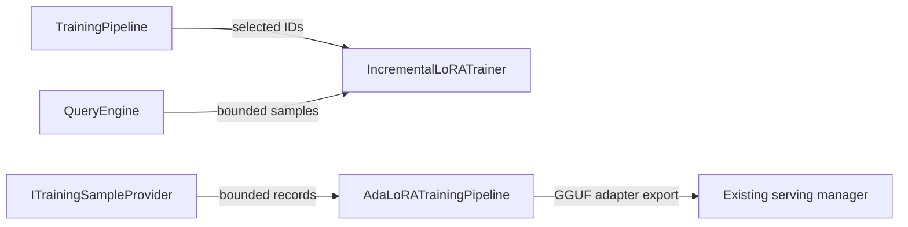

Exact model backend not verifiable from final document text alone.

# Training Module

## Zweck

This module implements training-data preparation, LoRA/AdaLoRA adapters,
incremental training, checkpoint and provenance handling, selection, and
training-pipeline orchestration. Its public contracts are declared in
[`../../include/training/`](../../include/training/). This overview describes
the current implementation; it does not assert release readiness or that every
planned data path is complete.

## Scope

| Component | Responsibility |
|---|---|
| `auto_labeler.cpp`, `database_domain_auto_labeler.cpp` | Create labeled samples from configured inputs |
| `modality_parser.cpp` | Extract text clauses, tables, citations, and modality-tagged samples |
| `knowledge_graph_enricher.cpp` | Add graph context and optionally query an injected vector index |
| `lora_data_selection.cpp` | Filter, de-duplicate, cluster, score, and audit sample selection |
| `docs_db_training_sample_provider.cpp` | Read bounded, normalized samples from docs.db without mutating the source |
| `adalora_training_pipeline.cpp` | Provider-neutral model consumer, AQL adapter, next-token AdaLoRA updates, and GGUF export |
| `incremental_lora_trainer.cpp`, `multi_task_lora.cpp` | Train/update adapters and report training results |
| `lora_adapter.cpp`, `ada_lora_adapter.cpp`, `lora_adapter_merger.cpp` | Adapter representation, adaptive rank, and merge operations |
| `lora_checkpoint_manager.cpp` | Checkpoint persistence, validation, and recovery |
| `provenance_tracker.cpp` | Record sample lineage and provenance |
| `training_pipeline.cpp`, `adapter_serving.cpp` | Coordinate configured stages and adapter-serving handoff |

## Integrationsueberblick

`TrainingPipeline` runs enabled labeling, enrichment, quality/drift, selection,
and training stages according to `PipelineConfig`. Individual components also
expose their own interfaces; their input types and failure results are defined
in the corresponding public headers.


**Kurzinterpretation:** The DB-backed selection/training path and the provider-based
AdaLoRA path are separate integrations; exporting an adapter does not prove its
activation, quality, or latency in serving.

The trainer supports bounded reads from its configured training collection
through an injected `QueryEngine`; invalid collections, query failures, and
empty valid datasets fail closed. With data selection enabled,
`TrainingPipeline` passes selected IDs to `trainSelected()`. The trainer filters
by `_key` before applying the bounded result limit and fails the run unless
every unique, non-empty selected ID has a valid non-empty input/output record.
This contract is covered by focused RocksDB tests, including keys outside the
unfiltered result prefix and partial selections.

The AdaLoRA-TT bridge preserves the effective alpha/rank scaling, reports
orthogonality only when its configured tolerance passes, and stores serialized
exports as `TensorNetworkStorageEngine` metadata. Restart durability depends on
the configured backend; its fingerprint/similarity index remains in-process.
`mapAdapter()` is only an injected hook and does not prove a serving handoff or
latency. `TrainingDataIterator` is owned by `llm`, not this module. Broader
input-route benchmarks and end-to-end acceptance remain open in
[`ROADMAP.md`](./ROADMAP.md).

### Provider-to-Consumer AdaLoRA Path

`ITrainingSampleProvider` is the source boundary. The AQL adapter reads any
authorized collection supported by `TrainingDataIterator`; the docs.db provider
is a concrete, read-only adapter for generated RocksDB documentation records.
It prefers complete `chunk_` entries and falls back to legacy `doc_` text
previews. Both produce the same bounded `TrainingSampleRecord` batches for
`AdaLoRATrainingPipeline::trainFromProvider()`. The consumer freezes the GGUF
base model, trains the output LoRA factors, checkpoints them, and exports a
standard GGUF adapter for the existing serving manager.

This integration does not itself enforce a caller authorization policy or
cryptographically sign the exported adapter. Those remain explicit production
requirements; callers must authorize the source and deployments must gate
serving on their approved artifact-verification process.

## Quickstart (Build/Run)

Training tests under [`../../tests/training/`](../../tests/training/) are
registered as focused targets with the `training` label and a 120-second
timeout. Use the repository's supported CMake preset and build directory, then
build the target for the changed component. See
[`MODULE_GUIDE.md`](./MODULE_GUIDE.md) for example commands and test selection.
Training benchmarks are optional and require `THEMIS_BUILD_BENCHMARKS=ON`; see
[`../../benchmarks/training/README.md`](../../benchmarks/training/README.md).

From a configured build directory, build a focused target and run the training
label:

```sh
cmake --build <build-dir> --target module_training_test_training_pipeline_e2e_focused
ctest --test-dir <build-dir> -L training --output-on-failure
```

## API/CLI Einstieg

The module exposes C++ interfaces rather than a standalone training CLI. Start
with [`API.md`](./API.md) and the public declarations in
[`../../include/training/`](../../include/training/); `TrainingPipeline`,
`IncrementalLoRATrainer`, `ITrainingSampleProvider`, and
`AdaLoRATrainingPipeline` are the principal orchestration, training, source,
and consumer entry points.

## Known Limitations

- Selection clustering uses a character-statistic heuristic rather than the
  configured embedding model.
- The optional OCR path does not return recognized image text.
- Restart durability depends on the configured tensor-storage backend; the
  AdaLoRA-TT fingerprint/similarity index remains in-process.
- The adapter mapping hook is injected and does not demonstrate a production
  serving handoff or latency.
- Deployment authorization, cryptographic artifact signing, representative
  latency evidence, and end-to-end acceptance remain open.

See [`MODELING.md`](./MODELING.md), [`EMBEDDING.md`](./EMBEDDING.md), and
[`ROADMAP.md`](./ROADMAP.md) for source-backed details and remaining gates.

## Verweise

- [`API.md`](./API.md) — public interface index and integration expectations.
- [`ARCHITECTURE.md`](./ARCHITECTURE.md) — module boundaries and data flow.
- [`IMPLEMENTATION.md`](./IMPLEMENTATION.md) — implementation invariants and
  focused validation.
- [`RUNBOOK.md`](./RUNBOOK.md) — training and checkpoint incident diagnosis.
- [`SECURITY.md`](./SECURITY.md) and [`TRUST.md`](./TRUST.md) — controls and
  trust boundaries.
- [`ROADMAP.md`](./ROADMAP.md) and
  [`FUTURE_ENHANCEMENTS.md`](./FUTURE_ENHANCEMENTS.md) — current work and
  planned changes.
