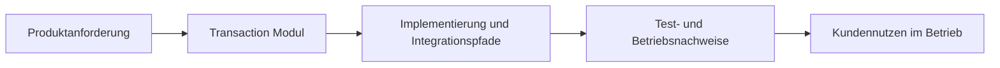

Exact model backend not verifiable from final document text alone.

Source level: 1; SOT domain: module-behavior. Canonical references: `include/transaction/transaction_manager.h`, `include/transaction/distributed_transaction_manager.h`, `include/transaction/saga.h`, and `src/transaction/transaction_manager.cpp`. Related issue: #7390.

# Transaction in ThemisDB

## Ueberblick
Das Modul enthält lokale Transaktions- und MVCC-APIs, Locking, verteilte Koordinationskomponenten sowie Saga- und Snapshot/Branch-Hilfen. Die Header belegen keine allgemeine atomare Garantie über unabhängige Index-, Netzwerk- oder Service-Nebenwirkungen; konkrete Grenzen sind in den jeweiligen Verträgen zu prüfen. Im Modulkontext werden Aussagen mit [Architekturgrenzen](./ARCHITECTURE.md), [Release-Planung](./ROADMAP.md) und [Produktionsanforderungen](./PRODUCTION_REQUIREMENTS.md) abgeglichen.

## Kern-Features im Detail
Die erste Kernfaehigkeit ist **ACID transaction lifecycle: begin, commit, rollback**. Das beschreibt einen konkreten, in den Modulquellen referenzierten Verantwortungsbereich.

Die zweite Kernfaehigkeit ist **SAGA pattern: step execution + compensating actions**. Dadurch bleiben Integrationspfade zwischen Modulgrenzen reproduzierbar und operativ auswertbar.

Die dritte Kernfaehigkeit ist **SAGA orchestration and multi-step coordination**. Das unterstuetzt stabile Abnahme- und Aenderungsprozesse entlang der Modul-Roadmap.

## Kundennutzen und Abgrenzung
Kundinnen und Kunden erhalten damit vor allem besser planbares Systemverhalten, kuerzere Eingrenzungszeiten bei Stoerungen und transparentere Release-Risiken. Diese Seite ist ein fachlich-kommunikativer Ueberblick; normative API-, Compliance- und Freigabeaussagen verbleiben in den kanonischen Modulquellen.

## Einordnung und Quellen
Primaere modulnahe Quellen: [README.md](./README.md), [ARCHITECTURE.md](./ARCHITECTURE.md), [ROADMAP.md](./ROADMAP.md), [FUTURE_ENHANCEMENTS.md](./FUTURE_ENHANCEMENTS.md), [PRODUCTION_REQUIREMENTS.md](./PRODUCTION_REQUIREMENTS.md), [SECURITY.md](./SECURITY.md). Sekundaere Querschnittsquellen: [docs/transaction/README.md](./../../docs/transaction/README.md), [Compendium Index](./../../docs/compendium/docs/index.md). Aussagen wurden auf diese Quellenbasis begrenzt; bei fehlenden Modulquellen werden keine weitergehenden Produktclaims ergänzt.
