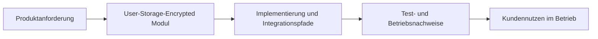

Exact model backend not verifiable from final document text alone.

# User-Storage-Encrypted in ThemisDB

## Ueberblick
Das Modul user_storage_encrypted stellt encrypted user-storage behavior for ThemisDB through a gocryptfs-backed mount backend, key derivation behavior, key rotation scheduling, and multi-tier encrypted storage orchestration. Im Modulkontext werden Aussagen mit [Architekturgrenzen](./ARCHITECTURE.md), [Release-Planung](./ROADMAP.md), [Produktionsanforderungen](./PRODUCTION_REQUIREMENTS.md) abgeglichen. Im Betrieb sind dabei insbesondere [Latenz](https://en.wikipedia.org/wiki/Latency_(engineering)), [Observability](https://en.wikipedia.org/wiki/Observability) und [Determinismus](https://en.wikipedia.org/wiki/Deterministic_algorithm) relevante Qualitaetskriterien. Fuer Querschnittskontext wird das Modul mit den relevanten Stellen im [Compendium](./../../docs/compendium/docs/index.md) verknuepft.

## Kern-Features im Detail
Die erste Kernfaehigkeit ist **gocryptfs-backed container lifecycle behavior**. Das beschreibt einen konkreten, in den Modulquellen referenzierten Verantwortungsbereich.

Die zweite Kernfaehigkeit ist der **standalone key-derivation service**. Die Modulquellen zeigen keine KDF-Injektion in den Multi-Level-Plugin-Backend-Konstruktor.

Die dritte Kernfaehigkeit ist ein **separater key-rotation scheduler**. Die Rotation ist derzeit nicht automatisch an die Multi-Level-Orchestrierung angebunden; Details stehen in [Roadmap](./ROADMAP.md).

## Kundennutzen und Abgrenzung
Kundinnen und Kunden erhalten damit vor allem besser planbares Systemverhalten, kuerzere Eingrenzungszeiten bei Stoerungen und transparentere Release-Risiken. Diese Seite ist ein fachlich-kommunikativer Ueberblick; normative API-, Compliance- und Freigabeaussagen verbleiben in den kanonischen Modulquellen.

## Einordnung und Quellen
Primaere modulnahe Quellen: [README.md](./README.md), [ARCHITECTURE.md](./ARCHITECTURE.md), [ROADMAP.md](./ROADMAP.md), [FUTURE_ENHANCEMENTS.md](./FUTURE_ENHANCEMENTS.md), [PRODUCTION_REQUIREMENTS.md](./PRODUCTION_REQUIREMENTS.md), [SECURITY.md](./SECURITY.md). Sekundaere Querschnittsquellen: [docs/user_storage_encrypted/README.md](./../../docs/user_storage_encrypted/README.md), [Compendium Index](./../../docs/compendium/docs/index.md). Aussagen wurden auf diese Quellenbasis begrenzt; bei fehlenden Modulquellen werden keine weitergehenden Produktclaims ergänzt.
