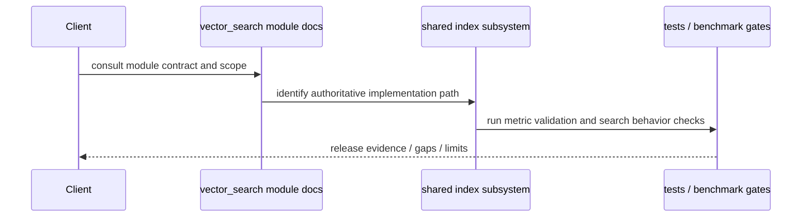

# Architecture — Vector Search Module

## Context

The vector-search module is a governance-facing summary around the shared index subsystem. The actual implementation remains in `src/index/` and `include/index/`, and this directory is responsible for documenting ownership boundaries, validation evidence, and release constraints without re-implementing the runtime.

## Components

### Governance layer

The files in `src/vector_search/` summarize the module contract and references to tests, benchmarks, and operational risk. This layer provides:
- scope and release boundaries
- links to the live index implementation
- operational limits and known gaps
- evidence references for tests and benchmarks

### Shared index runtime layer

The canonical implementation is in:
- `include/index/vector_index.h`
- `include/index/multi_vector_search.h`
- `src/index/vector_index.cpp`
- `src/index/advanced_vector_index.cpp`
- `src/index/multi_vector_search.cpp`

These sources own the actual ANN/vector behavior, metric validation, and result ordering logic.

## Interfaces

- Public runtime contracts: `include/index/*`
- Module documentation: `src/vector_search/*.md`
- Stress validation: `tests/vector_search/test_vector_search_highcardinality_stress.cpp`
- Release benchmark gate: `benchmarks/vector_search/bench_vector_search_dedicated_gates.cpp`

## Data Flow

```text
query / insert input
       |
       v
module governance boundary
       |
       v
shared index implementation (src/index, include/index)
       |
       +--> metric validation
       +--> ANN / exact search execution
       +--> result ranking / error return
       |
       v
validation artifacts and operational review
```

Interpretation: live runtime behavior is assembled in the shared index subsystem, while this module documents responsibility, validation, and release posture.

## Sequence (critical flow)



## Failure Paths and Resilience

- invalid dimensions, NaN/Inf values, and unsupported metrics fail closed at the shared runtime boundary
- empty-index and no-result conditions remain explicit operational states, not silent fallbacks
- corruption or unsafe resource states are treated as failure paths to be surfaced to callers and tracked in `MODULE_GAPS.md`
- parameter and performance tuning remain tracked in `PERFORMANCE_EXPECTATIONS.md` and `MODULE_GAPS.md` rather than being presented as shipped features
- large-scale or sharded index work remains planned and is not documented as active production behavior

### Concrete contract notes

- Validation and release constraints are documented in `PRODUCTION_REQUIREMENTS.md` and `PERFORMANCE_EXPECTATIONS.md`.
- The module uses the shared `index` subsystem as source-of-truth; the governance directory is not a second runtime implementation surface.
- The known operational edge cases and gap register remain in `MODULE_GAPS.md`.

### Concurrency and thread-safety contract

- read-heavy concurrent access is expected for the shared index layer; writes remain exclusive and are serialized by the authoritative runtime implementation
- validation gates and input checks occur before mutation or result generation, preventing unsafe state transitions under concurrent load
- the module keeps this as a documented boundary contract rather than re-implementing the concurrency detail in this directory

### Measurable performance and release expectations

- insertion throughput remains measured against the release gate in `PERFORMANCE_EXPECTATIONS.md`, with the current operational baseline at or above 1,000 ops/sec P95
- query latency remains bounded to the release gate in the same file, with the current baseline at or below 10 ms P99 for the 128-dim k=10 case
- concurrent throughput and memory overhead remain operationally tracked in the benchmark gate and the module gap register, with the current baseline above 500 ops/sec at 4 threads and under 40% overhead

## Non-Goals

- no duplicate vector-search implementation under `src/vector_search/`
- no claiming of distributed persistence/sharding as already shipped features
- no hidden feature drift between governance docs and the actual shared-index sources

## References

- [README.md](README.md)
- [ROADMAP.md](ROADMAP.md)
- [FUTURE_ENHANCEMENTS.md](FUTURE_ENHANCEMENTS.md)
- [AUDIT.md](AUDIT.md)
- [SECURITY.md](SECURITY.md)
- [PRODUCTION_REQUIREMENTS.md](PRODUCTION_REQUIREMENTS.md)
- [PERFORMANCE_EXPECTATIONS.md](PERFORMANCE_EXPECTATIONS.md)
- [MODULE_GAPS.md](MODULE_GAPS.md)
- [CHANGELOG.md](CHANGELOG.md)
- [../../src/index/README.md](../../src/index/README.md)
- [../../include/index/vector_index.h](../../include/index/vector_index.h)
- [../../include/index/multi_vector_search.h](../../include/index/multi_vector_search.h)
- [../../src/index/ann_frontdoor.cpp](../../src/index/ann_frontdoor.cpp)
- [../../tests/vector_search/test_vector_search_highcardinality_stress.cpp](../../tests/vector_search/test_vector_search_highcardinality_stress.cpp)
- [../../benchmarks/vector_search/bench_vector_search_dedicated_gates.cpp](../../benchmarks/vector_search/bench_vector_search_dedicated_gates.cpp)
