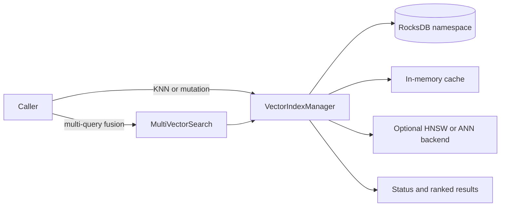
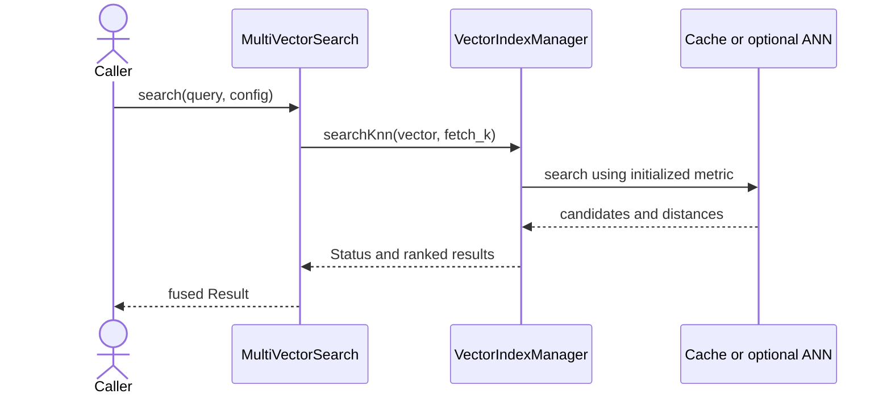

Exact model backend not verifiable from final document text alone.

# Architecture — Vector Search Module

## Kontext

`src/vector_search/` is a documentation boundary only. The runtime belongs to
the shared index subsystem in `include/index/` and `src/index/`. The public
contracts most directly relevant to this module are
`VectorIndexManager` and `MultiVectorSearch`; neither is implemented in this
directory.

## Komponenten

- **VectorIndexManager:** owns a vector namespace backed by RocksDB. It exposes
  entity mutation, KNN and filtered search, statistics, reindex/rebuild, and
  save/load operations. HNSW acceleration is optional and build-dependent;
  brute-force search is also supported.
- **MultiVectorSearch:** combines results from vector queries, query expansions,
  or keyword scores using configured fusion strategies. The current
  `searchMultiField()` implementation does not select field-specific indexes;
  it repeats one query vector through the shared manager.
- **AdvancedVectorIndex:** optional backend integration configured through the
  shared index API. `setAdvancedIndexConfig()` can report unsupported
  configurations through `Status`; some backend-specific cases, such as
  unavailable DiskANN support, warn and fall back during initialization.
- **DistributedVectorIndex:** a separate in-process, sharded ANN implementation
  in `src/index/`. Its presence does not imply durable replication or a
  production multi-node service.

## Schnittstellen

The public contracts are `VectorIndexManager` in `include/index/vector_index.h`
and `MultiVectorSearch` in `include/index/multi_vector_search.h`. The manager
returns `Status` plus result data for KNN operations; the aggregation methods
return `Result<MultiSearchResult>` (or a vector of those results for batch
search). Mutations and index lifecycle remain the manager's responsibility.

## Datenfluss

Kurzinterpretation: Vector entities are stored through the shared RocksDB
namespace; searches use the configured in-memory or optional ANN path. Fusion
delegates individual searches to the manager and does not add another storage
backend.

Vector inputs and index configuration are passed through the shared public
interfaces. The manager reports failures through `Status`; `searchKnn()` checks
query dimensions, and the `WriteBatchWrapper` and MVCC `addEntity` overloads
check inserted dimensions. The direct-commit `addEntity` overload does not
currently check vector length. The API does not define the numeric E5400-series
error taxonomy claimed by older module documents.

## Sequenz (kritischer Ablauf)

Kurzinterpretation: The manager checks the query dimension and returns a status
with ranked candidates; multi-vector search fuses those candidates. A single
vector query may call the manager directly.

## Fehlerpfade und Resilienz

- Initialization rejects an empty namespace or a non-positive dimension.
- `searchKnn()` rejects a query dimension that does not match the initialized
  index. Search does not accept a separate metric argument; the index metric is
  selected at initialization.
- Entity operations can fail when the manager is uninitialized, the vector
  field is absent or malformed, storage operations fail, or optional encryption
  fails.
- Advanced index configuration can return an error when the requested support
  is unavailable in the build.
- FAISS advanced configurations require `THEMIS_GPU_ENABLED`; ScaNN is
  initialized without that flag. If DiskANN support is not compiled in,
  initialization warns, disables that advanced configuration, and continues
  on the standard indexing path.
- `MultiVectorSearch::SearchConfig::index_name` and `ef_search` are declared
  but are not read by the current implementation.
- Finite-value (`NaN`/`Inf`) validation is not established by the current source
  and remains unverified.
- HNSW availability is conditional; callers must not assume a particular
  backend solely from the module name.
- `searchMultiField()` and `MultiQuery` field metadata do not currently implement
  field-specific routing or `require_all_fields` behavior.
- Persistence APIs exist for the HNSW index, and vector entities are stored
  through the RocksDB-backed namespace. This does not establish distributed
  persistence or replication.

## Validation evidence

The module-specific high-cardinality stress and integration soak fixtures use
flat in-process indexes. The dedicated benchmark also uses a synthetic flat
index. These are useful fixture-level checks but do not validate the production
runtime's ANN performance or release readiness. See
[performance expectations](PERFORMANCE_EXPECTATIONS.md) and
[module gaps](MODULE_GAPS.md).

## Nicht-Ziele

- Duplicating the index runtime under `src/vector_search/`.
- Treating optional backends or in-process sharding as production guarantees.
- Publishing benchmark thresholds as measured production baselines without
  runtime-backed measurements.

## Verweise

- [README](README.md) · [API](API.md) · [Implementation](IMPLEMENTATION.md)
- [Roadmap](ROADMAP.md) · [Security](SECURITY.md)
- [`VectorIndexManager`](../../include/index/vector_index.h)
- [`MultiVectorSearch`](../../include/index/multi_vector_search.h)
- [`DistributedVectorIndex`](../../include/index/distributed_vector_index.h)
