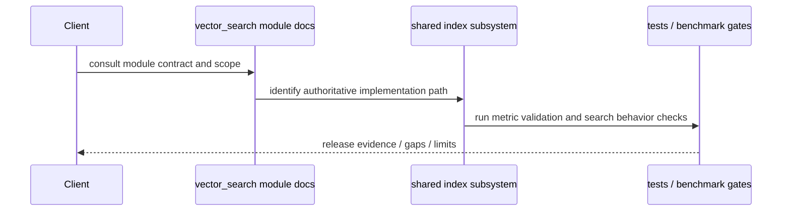

# Architecture — Vector Search Module

## Kontext

The vector-search module is a governance-facing summary around the shared index subsystem. The actual implementation remains in `src/index/` and `include/index/`, and this directory is responsible for documenting ownership boundaries, validation evidence, and release constraints without re-implementing the runtime.

## Komponenten

### Governance layer

The files in `src/vector_search/` summarize the module contract and references to tests, benchmarks, and operational risk. This layer provides:
- scope and release boundaries
- links to the live index implementation
- operational limits and known gaps
- evidence references for tests and benchmarks

### Shared index runtime layer

The canonical implementation is in:
- `include/index/vector_index.h`
- `include/index/multi_vector_search.h`
- `src/index/vector_index.cpp`
- `src/index/advanced_vector_index.cpp`
- `src/index/multi_vector_search.cpp`

These sources own the actual ANN/vector behavior, metric validation, and result ordering logic.

## Schnittstellen

- Public runtime contracts: `include/index/*`
- Module documentation: `src/vector_search/*.md`
- Stress validation: `tests/vector_search/test_vector_search_highcardinality_stress.cpp`
- Release benchmark gate: `benchmarks/vector_search/bench_vector_search_dedicated_gates.cpp`

## Datenfluss

```text
query / insert input
       |
       v
module governance boundary
       |
       v
shared index implementation (src/index, include/index)
       |
       +--> metric validation
       +--> ANN / exact search execution
       +--> result ranking / error return
       |
       v
validation artifacts and operational review
```

Kurzinterpretation: live runtime behavior is assembled in the shared index subsystem, while this module documents responsibility, validation, and release posture.

## Sequenz (kritischer Ablauf)



## Fehlerpfade und Resilienz

- invalid dimensions and unsupported metrics fail closed at the shared runtime boundary
- known gaps remain tracked explicitly in `MODULE_GAPS.md` instead of being implied as live features
- large-scale or sharded index work remains planned and is not documented as active production behavior

## Nicht-Ziele

- no duplicate vector-search implementation under `src/vector_search/`
- no claiming of distributed persistence/sharding as already shipped features
- no hidden feature drift between governance docs and the actual shared-index sources

## Verweise

- [README.md](README.md)
- [ROADMAP.md](ROADMAP.md)
- [FUTURE_ENHANCEMENTS.md](FUTURE_ENHANCEMENTS.md)
- [MODULE_GAPS.md](MODULE_GAPS.md)
- [../../src/index/README.md](../../src/index/README.md)
- [../../include/index/vector_index.h](../../include/index/vector_index.h)
- [../../include/index/multi_vector_search.h](../../include/index/multi_vector_search.h)
