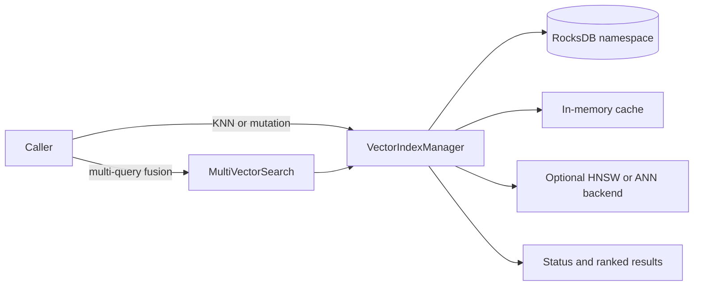

Exact model backend not verifiable from final document text alone.

# Vector Search Module

## Zweck

This directory is the documentation and governance boundary for vector search.
It contains no vector-search implementation source. The shared runtime is owned
by the `index` subsystem under `include/index/` and `src/index/`; this module
must not be treated as a second implementation or an independent release claim.

## Scope

The primary runtime interfaces are `VectorIndexManager` and `MultiVectorSearch`.
The former stores vectors in a RocksDB-backed namespace and can use optional
HNSW acceleration; the latter combines results from multiple vector queries,
query expansions, or keyword scores. Its `searchMultiField()` API does not
currently route to field-specific indexes. Optional advanced and distributed
index implementations also live in the shared index subsystem and have
separate capability and readiness limits.

## Quickstart (Build/Run)

Use a configure preset available in the repository's `CMakePresets.json`:

```bash
cmake --list-presets
cmake --preset <available-preset>
cmake --build --preset <available-preset> --target test_vector_search_highcardinality_stress
ctest --preset <available-preset> -R 'vector_search' --output-on-failure
```

The release configure preset may disable tests. Use a test-enabled preset when
building this test target.

The high-cardinality stress test and soak test use in-process flat-index
implementations. They validate those test fixtures, not the production
`VectorIndexManager` runtime. The dedicated vector-search gate benchmark also
uses an in-process flat index and emits threshold counters; it is not measured
production-runtime performance evidence. See [performance expectations](PERFORMANCE_EXPECTATIONS.md)
and [module gaps](MODULE_GAPS.md) for evidence boundaries.

## Installation

There is no module-specific installation step. Vector search is part of the
shared `index` subsystem; the available ANN backend depends on build-time
support.

## API/CLI Einstieg

There is no standalone vector-search CLI or executable. Integrators use
[`VectorIndexManager`](../../include/index/vector_index.h) for storage-backed
index lifecycle and KNN operations, and
[`MultiVectorSearch`](../../include/index/multi_vector_search.h) for result
fusion. See [API contract](API.md) for current signatures and known limitations.

## Usage

Use the `VectorIndexManager` and `MultiVectorSearch` APIs through the ThemisDB
runtime; there is no separate vector-search process to launch. Follow the
configuration and validation notes in the [API contract](API.md).

## Integrationsueberblick



Kurzinterpretation: The shared manager owns persistence and index operations;
multi-query fusion delegates searches to it. The optional ANN path depends on
the build configuration, and the diagram does not imply a distributed service.

## Live source and evidence

- API: [`include/index/vector_index.h`](../../include/index/vector_index.h),
  [`include/index/multi_vector_search.h`](../../include/index/multi_vector_search.h)
- Runtime: [`src/index/vector_index.cpp`](../index/vector_index.cpp),
  [`src/index/multi_vector_search.cpp`](../index/multi_vector_search.cpp)
- Stress test fixture: [`tests/vector_search/test_vector_search_highcardinality_stress.cpp`](../../tests/vector_search/test_vector_search_highcardinality_stress.cpp)
- Soak test fixture: [`tests/integration/test_vector_search_soak.cpp`](../../tests/integration/test_vector_search_soak.cpp)
- Dedicated gate benchmark: [`benchmarks/vector_search/bench_vector_search_dedicated_gates.cpp`](../../benchmarks/vector_search/bench_vector_search_dedicated_gates.cpp)
- Runtime benchmark: [`benchmarks/ann/bench_vector_search.cpp`](../../benchmarks/ann/bench_vector_search.cpp)

## Known limitations

- Optional HNSW and advanced-index behavior depends on build-time support.
- `DistributedVectorIndex` is a shared-index implementation, not evidence of
  durable, replicated, multi-node production service. Its `RANGE` strategy is
  currently hash-based and replication is marked future work in its API.
- The dedicated gate benchmark and named stress/soak fixtures do not establish
  production latency, throughput, recall, or release readiness.
- Production readiness requires runtime-specific validation and maintainer
  sign-off; this module's documentation does not grant that sign-off.

## Verweise

- [Architecture](ARCHITECTURE.md)
- [API contract](API.md)
- [Implementation notes](IMPLEMENTATION.md)
- [Roadmap](ROADMAP.md)
- [Audit](AUDIT.md)
- [Changelog](CHANGELOG.md)
- [Future enhancements](FUTURE_ENHANCEMENTS.md)
- [Module gaps](MODULE_GAPS.md)
- [Performance expectations](PERFORMANCE_EXPECTATIONS.md)
- [Production requirements](PRODUCTION_REQUIREMENTS.md)
- [Security](SECURITY.md)
- [Runbook](RUNBOOK.md)
